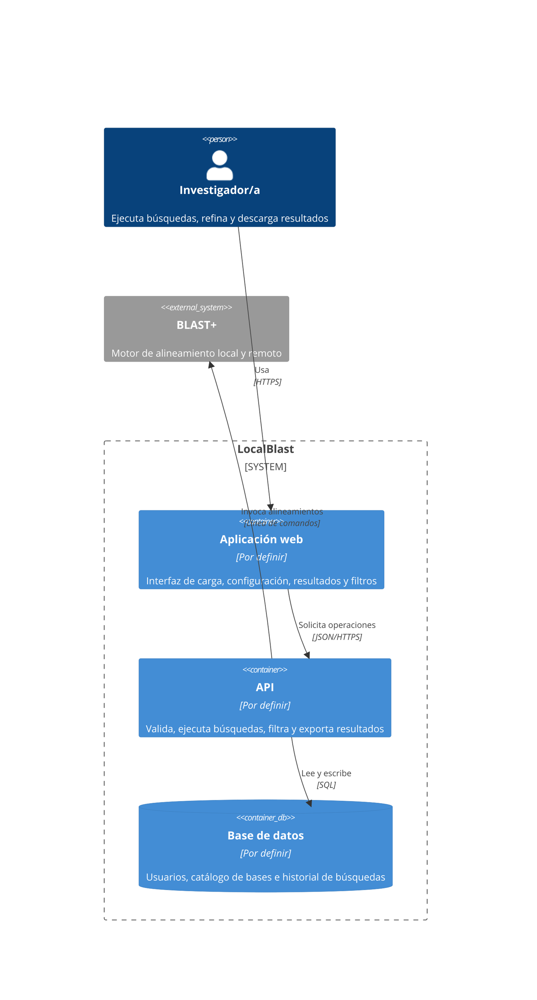
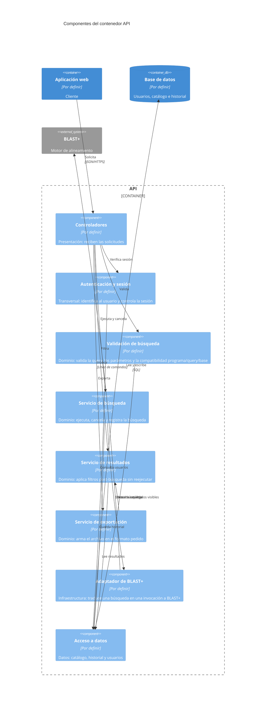

# Documento de Especificación de Arquitectura — LocalBlast

Este documento define la arquitectura de LocalBlast para los procesos de **ejecución de búsqueda BLAST (P1)** y **filtrado y entrega de resultados (P2)**. Representa las decisiones estructurales con las vistas de contenedores y componentes del modelo C4 (Context, Containers, Components, Code), apoyándose en los escenarios de atributo de calidad del sistema para justificar cada decisión.

---

## Índice

1. [Introducción](#1-introducción)
2. [Restricciones](#2-restricciones)
3. [Contexto](#3-contexto)
4. [Drivers arquitectónicos](#4-drivers-arquitectónicos)
5. [Estrategia de solución](#5-estrategia-de-solución)
6. [Vista de contenedores](#6-vista-de-contenedores)
7. [Vistas de componentes](#7-vistas-de-componentes)
8. [Historias de usuario sobre las vistas](#8-historias-de-usuario-sobre-las-vistas)
9. [Decisiones de arquitectura](#9-decisiones-de-arquitectura)
10. [Trazabilidad](#10-trazabilidad)
11. [Glosario](#11-glosario)

---

## 1. Introducción

### 1.1 Propósito

Describir las decisiones estructurales de LocalBlast que atienden los escenarios de calidad críticos del sistema, y representarlas con las vistas de contenedores y componentes del modelo C4. El documento es la línea base arquitectónica para el desarrollo iterativo del sistema.

### 1.2 Alcance

La arquitectura se define para los dos procesos del sistema que se desarrollan en el alcance actual:

- **P1 · Ejecutar búsqueda BLAST** (casos de uso CU001 a CU005).
- **P2 · Filtrar y entregar resultados** (casos de uso CU006 y CU007).

El proceso **P3 · Administrar bases de datos** queda fuera del alcance del cuatrimestre (ver [SRS, sección 1.4](../requeriments/srs.md#14-fuera-del-alcance)); su actor Administrador/a y el flujo de administración del catálogo no se detallan en estas vistas.

Las vistas de clases y de código, y los diagramas de despliegue, no forman parte de este documento: se desarrollarán en una iteración posterior.

### 1.3 Audiencia

- **Equipo de desarrollo** de LocalBlast: usa el documento como guía de construcción.
- **Integrantes futuros** del proyecto: lo consultan al incorporarse para entender rápidamente la estructura del sistema y las razones de cada decisión.

### 1.4 Siglas

Las siglas se definen la primera vez que se usan en el cuerpo del documento. El glosario completo está en la [sección 11](#11-glosario).

---

## 2. Restricciones

| Tipo | Restricción | Cómo condiciona la arquitectura |
|---|---|---|
| **Tecnología externa obligatoria** | BLAST+ (versión 2.14 o posterior) está instalado en el servidor; LocalBlast lo usa, no lo empaqueta ni lo reimplementa | BLAST+ es un sistema externo que se invoca, no un contenedor propio |
| **Técnica** | En modo remoto es BLAST+ quien contacta a NCBI (flag `-remote`); LocalBlast no dialoga con NCBI | No hay relación directa entre LocalBlast y NCBI en los diagramas |
| **Técnica** | El catálogo de bases locales (D1) se puebla por fuera del sistema (P3 fuera de alcance) | El catálogo se lee, no se escribe desde la aplicación |
| **Técnica** | Los usuarios se dan de alta por fuera del sistema; solo hay autenticación básica | La arquitectura incorpora unicamente un aspecto transversal simple de autenticacion (login/logout) para proteger y vincular el historial a cada investigador |
| **Equipo** | El equipo se compone por 3 estudiantes | No se adoptan arquitecturas de alta complejidad operativa |
| **Tiempo** | Duración disponible: un cuatrimestre | Se acota el alcance arquitectonico a los procesos criticos (P1 y P2) |
| **Tecnológica** | Lenguajes y frameworks que el equipo ya domina | El equipo domina lenguajes como Python y bases de datos relacionales. Para el frontend el equipo adopta **React**, con una curva de aprendizaje asumible dentro del cuatrimestre pero tiene tiempo limitado para aprender otras tecnologias o lenguajes completamente nuevos |

---

## 3. Contexto

El diagrama de contexto del sistema, con sus actores humanos (Investigador/a y Administrador/a) y el único sistema externo con el que dialoga (BLAST+), se desarrolla en el documento dedicado del repositorio:

👉 [`contexto-inicial.md`](contexto-inicial.md)

Para el alcance de este documento conviene retener dos aclaraciones del contexto, porque condicionan directamente las decisiones de arquitectura:

- **Local vs. remoto es transparente para LocalBlast.** La diferencia entre modo local y modo remoto queda enteramente del lado de BLAST+: en modo local lee índices del servidor del laboratorio; en modo remoto recibe la flag `-remote` y él mismo dialoga con NCBI. Nuestro sistema no implementa cliente HTTP hacia NCBI. Para LocalBlast, los dos modos son la misma operación —invocar BLAST+ con argumentos distintos— y la arquitectura los trata uniformemente.
- **Procesos profundizados.** Solo P1 y P2 entran en esta arquitectura; el actor Administrador/a y el proceso P3 quedan documentados en el contexto pero no se detallan acá.

---

**Descripción de elementos:**

| Elemento | Tipo | Responsabilidad |
|---|---|---|
| Investigador/a | Persona | Actor que hace uso del sistema |
| LocalBlast | Sistema | Sistema principal que permite la comunicacion con la API |
| BLAST+ | Sistema externo | Sistema encargado de ejecutar los alineamientos locales |

---

## 4. Drivers arquitectónicos

### 4.1 Elección del atributo de calidad como driver

De los cinco atributos de calidad priorizados en el documento de [escenarios de calidad](../requeriments/quality-scenarios/escenarios-calidad.md), elegimos un único atributo como **driver arquitectónico**: **Interoperabilidad** (Compatibilidad / Interoperabilidad en ISO/IEC 25010:2023).

**Por qué este y no otro:**

- **Es condición de existencia del producto.** LocalBlast *es*, por definición, una interfaz gráfica para BLAST+. Toda ejecución —local o remota— termina siendo una invocación al binario externo y un parseo de su salida. Sin interoperabilidad con BLAST+ el sistema no existe; con los otros atributos, LocalBlast puede ser menos ágil, menos robusto o menos modular, pero sigue siendo un sistema.
- **Fue el atributo más crítico en la matriz comparativa**, con 9 victorias sobre 9 posibles. Ningún otro atributo lo venció en ningún par.
- **Es el atributo que más condiciona la estructura.** La elección de cómo invocar a BLAST+, dónde alojar al adaptador, cómo aislar las versiones del binario del resto del código, y cómo manejar la concurrencia de subprocesos son decisiones estructurales. Los otros atributos se materializan sobre todo *dentro* de las piezas que la interoperabilidad obliga a crear:
  - *Operabilidad* se juega en la Aplicación Web (parte del cliente del estilo que vamos a elegir).
  - *Confidencialidad* se resuelve con TLS en el canal cliente-servidor y con el componente **Autenticación y sesión** del API (ver sección 7.1), que acompaña al estilo elegido pero no es un estilo propio.
  - *Tolerancia a fallos* se trata, en nuestro caso, delegando a BLAST+ el reporte de errores remotos y propagándolos sin reinterpretarlos: una responsabilidad del adaptador que la interoperabilidad exige crear.
  - *Modularidad* se obtiene en gran medida como consecuencia del patrón que la interoperabilidad justifica (ver [sección 5.3](#53-patrón-arquitectónico-capas)): aislar BLAST+ en una capa dedicada deja el resto del sistema modular por diseño.

**Qué hacen los otros atributos en esta arquitectura.** No se descartan: se cubren mediante decisiones de implementación y restricciones de desarrollo dentro de los contenedores y componentes que la interoperabilidad justifica. La elección de un único driver es una **decisión de énfasis**, no una renuncia a los otros atributos.

### 4.2 Escenarios seleccionados como drivers

De los dos escenarios de interoperabilidad disponibles, ambos son drivers arquitectónicos: cada uno condiciona la estructura del sistema de un modo distinto.

#### EC-01 · Sobrecarga por concurrencia de invocaciones

| Campo | Contenido |
|---|---|
| **Estímulo** | Hasta cinco investigadores lanzan búsquedas concurrentes contra el sistema, mezclando modo local y remoto. |
| **Respuesta esperada** | Cada búsqueda corre como subproceso independiente de BLAST+; los resultados se entregan a la sesión que los originó, sin cruce con otras. |
| **Medida** | **Cero** cruces de resultados con hasta cinco búsquedas concurrentes. |
| **Por qué condiciona la estructura** | Exige un contenedor servidor capaz de alojar subprocesos independientes de BLAST+ (uno por búsqueda), con un componente dedicado a mantener la correspondencia entre subproceso y sesión del investigador. No se puede resolver dentro de un único componente, ni solo en la interfaz. |

#### EC-02 · Degradado por cambio menor de versión de BLAST+

| Campo | Contenido |
|---|---|
| **Estímulo** | El administrador de sistemas actualiza BLAST+ a una versión posterior que suma columnas o campos a la salida, sin coordinarlo con el equipo de desarrollo. |
| **Respuesta esperada** | El parser reconoce los campos conocidos, ignora los nuevos sin corromper los conocidos, no aborta y registra una advertencia. |
| **Medida** | **100%** de las búsquedas con salida "casi conocida" presentan intactos los campos obligatorios. |
| **Por qué condiciona la estructura** | Exige un componente adaptador aislado entre el núcleo del sistema y BLAST+. Los demás componentes **no deben saber** cómo es la salida real del binario, para que un cambio en esa salida no se propague por todo el código. Es una decisión de dependencia estructural, no de implementación interna. |

La especificación completa de ambos escenarios, con todos sus componentes (fuente del estímulo, estímulo, entorno, artefacto, respuesta, medida), está en la sección 5.1 de [`escenarios-calidad.md`](../requeriments/quality-scenarios/escenarios-calidad.md#51-interoperabilidad).

### 4.3 Restricciones del proyecto que acompañan a los drivers

Dos restricciones de la [sección 2](#2-restricciones) influyen directamente en cómo se traducen estos drivers en estructura:

- **Equipo de 3 personas con dedicación parcial.** Toda alternativa de arquitectura que atienda los drivers debe ser realizable con ese presupuesto. Esto descarta soluciones de alta complejidad operativa aunque sean técnicamente superiores (ver [DA-01](#da-01--estilo-base-cliente-servidor) y [DA-02](#da-02--patrón-capas-en-los-contenedores-con-lógica-propia)).
- **Tecnologías dominadas o adoptables por el equipo.** El estilo elegido se realiza del lado servidor con Python (que el equipo ya domina) y, del lado cliente, con React (que el equipo adopta en el cuatrimestre).

---

## 5. Estrategia de solución

### 5.1 Tácticas por driver

<!-- Una táctica es una decisión de diseño, no una tecnología. Usar los nombres de la Tabla 2 del enunciado.
     Si se propone una táctica que no está en la tabla, aclararlo. -->

<!-- Una táctica es una decisión de diseño, no una tecnología. Usar los nombres de la Tabla 2 del enunciado.
     Si se propone una táctica que no está en la tabla, aclararlo. -->

| Driver | Atributo | Táctica elegida | Táctica descartada |
|---|---|---|---|
| `EC-01` | Tolerancia a fallos | **Manejo de excepciones:** Se define qué hacer (abortar y notificar al usuario) cuando el subproceso BLAST+ falla inesperadamente. | **Redundancia activa:** Descartada por las restricciones de recursos del servidor; no se levantarán múltiples instancias del motor BLAST+. |
| `EC-02` | Confidencialidad | **Identificar, autenticar y autorizar actores:** Se verifica la sesión del investigador para asegurar que solo acceda a su propio historial (D2). | **Registro de auditoría:** Descartada por el tiempo de desarrollo acotado; no se guardará un log exhaustivo de cada intento de acceso denegado. |
| `EC-03` | Interoperabilidad | **Adaptar la interfaz:** El componente Gestor de Ejecución traduce los parámetros de la interfaz web al comando CLI específico que espera BLAST+. | **Descubrir servicios:** Descartada porque la ruta al binario BLAST+ y a los servidores de NCBI es fija, no requiere descubrimiento dinámico en tiempo de ejecución. |
| `EC-05` | Modularidad | **Dividir módulos / Encapsular:** Se separa la lógica de búsqueda de la de presentación, permitiendo agregar el formato XML sin tocar el núcleo de dominio. | **Diferir el enlace (Plug-ins):** Descartada por sobreingeniería; la cantidad de formatos a soportar es finita y manejable mediante módulos fijos sin necesidad de plug-ins dinámicos. |

### 5.2 Estilo base

- **Estilo elegido: Cliente-Servidor** 
- **Por qué: Permite separar claramente la interfaz grafica de la logica de procesamiento, siendo ademas una arquitectura alineada con la experiencia tecnica del equipo y que permite construir en el tiempo disponible una solucion arquitectonica adecuada** 
- **Qué sacrifica: El servidor de la API se convierte en un punto único de falla (si el backend cae, la aplicación web completa queda inutilizable). Además, concentra toda la carga computacional de los alineamientos locales en un solo lugar** 
- **Comprobación de restricciones (Tabla 4):**

| Restricción o regla del estilo | ¿Se cumple? | Dónde se ve en el diagrama |
|---|---|---|
| Los clientes (instancias de la aplicación web en los navegadores de los investigadores) no se comunican entre sí | Sí | [...] |
| La Aplicación Web (cliente) no accede directamente a la base de datos (D2); toda petición de almacenamiento o recuperación pasa obligatoriamente por la API | Sí | [...] |
| Es el cliente quien siempre inicia la comunicación (al enviar los parámetros de búsqueda o solicitar el historial), y el servidor expone una interfaz definida (API REST) para atender dichas peticiones| Sí | [...] |

### 5.3 Estilos adicionales por zona

<!-- Solo si un escenario lo exige. Indicar qué zona del sistema y por qué. Si no hay, escribir "No se adoptan". -->

| Estilo | Zona donde aplica | Escenario que lo exige | Qué sacrifica |
|---|---|---|---|
| [...] | [...] | `EC-xx` | [...] |

### 5.4 Patrones por contenedor

| Contenedor | Patrón | Problema que resuelve | Qué sacrifica | Comprobación de restricciones (Tabla 6) |
|---|---|---|---|---|
| API | [por ejemplo, capas] | [...] | [...] | [...] |
| [...] | [...] | [...] | [...] | [...] |

### 5.5 Tabla de cobertura y sacrificios

| Driver | Cómo lo cubre la arquitectura | Qué se sacrifica |
|---|---|---|
| `EC-01` | [...] | [...] |
| `EC-02` | [...] | [...] |

### 5.6 Conflictos entre tácticas

<!-- Verificar que las tácticas de escenarios distintos no se contradigan. -->

| Tácticas en tensión | Escenarios | Cómo se resolvió |
|---|---|---|
| [...] | `EC-xx` / `EC-yy` | [...] |

---

## 6. Vista de contenedores

<!-- Reglas (secc. 4.4 del enunciado):
     - Una sola vista global, con título.
     - Dentro del límite del sistema solo contenedores; personas y sistemas externos van afuera.
     - Cada contenedor: nombre (rol, sin tecnología), tecnología y responsabilidad en una frase.
     - Bases de datos y colas son contenedores.
     - Un contenedor no contiene otros contenedores ni componentes.
     - Sin elementos aislados. Máximo aproximado: 10 elementos.
     - Flechas desde quien inicia, con verbo y protocolo; sin flecha de respuesta. -->

### 6.1 Diagrama (versión actual)

<!-- Punto de partida: cliente-servidor. Evolucionar con cada driver (ver 6.4).
     Reemplazar "Por definir" por la tecnología real. -->

<!-- Variante candidata si un driver (por ejemplo, tolerancia a fallos o ejecución asíncrona con cancelación)
     exige desacoplar la ejecución de la búsqueda: agregar una cola y un proceso separado.
     Solo se incorpora si queda justificada por una decisión DA-xx.

     ContainerQueue(cola, "Cola de búsquedas", "Por definir", "Solicitudes de búsqueda pendientes")
     Container(ejecutor, "Ejecutor de búsquedas", "Por definir", "Toma solicitudes, invoca BLAST+ y guarda resultados")
     Rel(api, cola, "Publica solicitudes", "AMQP")
     Rel(ejecutor, cola, "Consume solicitudes", "AMQP")
     Rel(ejecutor, bd, "Guarda resultados", "SQL")
     Rel(ejecutor, blast, "Invoca alineamientos", "Línea de comandos")
-->

### 6.2 Catálogo de contenedores

| Contenedor | Tecnología | Responsabilidad |
|---|---|---|
| Aplicación web | [...] | [...] |
| API | [...] | [...] |
| Base de datos | [...] | [...] |

### 6.3 Catálogo de relaciones

| Origen | Destino | Qué se comunica | Tipo | Protocolo |
|---|---|---|---|---|
| Investigador/a | Aplicación web | Uso de la interfaz | Persona hacia contenedor | HTTPS |
| Aplicación web | API | [...] | Síncrona | [...] |
| API | Base de datos | [...] | Acceso a datos | [...] |
| API | BLAST+ | [...] | Integración externa | [...] |

### 6.4 Evolución de la vista

<!-- Cada cambio significativo en la vista es una decisión de arquitectura (DA-xx). -->

| Versión | Driver | Decisión | Qué cambia en las vistas |
|---|---|---|---|
| v0 | Punto de partida | [Estilo base y patrón inicial] | [Contenedores iniciales] |
| v1 | `EC-xx` | `DA-xx` | [...] |
| v2 | `EC-xx` | `DA-xx` | [...] |

---

## 7. Vista de componentes

<!-- Una vista por cada contenedor que implementa P1 y P2 y tiene lógica propia.
     No se hace para bases de datos ni colas.
     Reglas (secc. 4.5 del enunciado):
     - Los componentes van dentro del límite de ese contenedor; lo externo va afuera sin sus componentes.
     - Un componente pertenece a un solo contenedor y no contiene otros componentes.
     - No son clases: son agrupaciones coherentes de funcionalidad.
     - Respetar las restricciones de los patrones elegidos (por ejemplo, en capas las dependencias van hacia abajo).
     - Los aspectos transversales adoptados se dibujan como componentes propios.
     - Sin componentes huérfanos: cada uno se rastrea a una HU, un RF o una DA.
     - Entre componentes la relación es una llamada interna: verbo, sin protocolo. -->

### 7.1 Contenedor API

#### Diagrama (versión actual)

<!-- Propuesta inicial a validar: capas + puerto/adaptador hacia BLAST+ (si se adopta el patrón hexagonal). -->

#### Catálogo de componentes

| Componente | Tecnología | Responsabilidad | Se rastrea a |
|---|---|---|---|
| Controladores | [...] | Reciben las solicitudes de la aplicación web | [RF / HU / DA] |
| Autenticación y sesión | [...] | [...] | [...] |
| Validación de búsqueda | [...] | [...] | RF-02, RF-05, RF-07 |
| Servicio de búsqueda | [...] | [...] | RF-03, RF-08, RF-10 |
| Servicio de resultados | [...] | [...] | RF-09, RF-11 |
| Servicio de exportación | [...] | [...] | RF-12 |
| Adaptador de BLAST+ | [...] | [...] | RF-03 |
| Acceso a datos | [...] | [...] | RF-10 |

#### Catálogo de relaciones

<!-- Entre componentes del mismo contenedor el tipo es "llamada interna" y no lleva protocolo. -->

| Origen | Destino | Qué se comunica | Tipo | Protocolo |
|---|---|---|---|---|
| Controladores | Autenticación y sesión | Verificación de sesión | Llamada interna | — |
| [...] | [...] | [...] | Llamada interna | — |

### 7.2 Otros contenedores

<!-- Agregar una subsección por cada contenedor que implemente P1 o P2 y tenga lógica propia
     (por ejemplo, el Ejecutor de búsquedas, si se incorpora, o la Aplicación web si el patrón
     MVC o MVVM aporta valor). Si no hay ninguno más, escribir "No aplica". -->

---

## 8. Historias de usuario sobre las vistas

<!-- Tomar cada HU de P1 y P2 y ubicar cada paso del Given-When-Then en un contenedor y en un componente.
     Si un paso no tiene dónde ocurrir, falta un contenedor, un componente o una relación. -->

| Historia de usuario | Paso del criterio de aceptación | Contenedores | Componentes |
|---|---|---|---|
| `HU[xx]_CU00[x]_[slice]` [nombre] | Given [...], When [...], Then [...] | [Aplicación web → API → Base de datos] | [Controladores → ... → Acceso a datos] |
| `HU[xx]_CU00[x]_[slice]` [nombre] | [...] | [...] | [...] |

---

## 9. Decisiones de arquitectura

<!-- Una entrada por decisión significativa. Cada driver debe tener al menos una decisión.
     Copiar la plantilla para cada nueva decisión. -->

### DA-01 — [Título corto de la decisión]

- **Escenario que la motiva:** [EC-xx y breve descripción]
- **Contexto:** [Qué problema o tensión hay que resolver y qué restricciones existen]
- **Decisión:**
  - Tácticas: [nombre y atributo, según la Tabla 2]
  - Estilo: [estilo base, o estilo aplicado a una parte del sistema, indicando cuál]
  - Patrón: [patrón aplicado y en qué contenedor, si corresponde]
- **Alternativas consideradas:**
  - [Alternativa 1] — descartada porque [motivo].
  - [Alternativa 2] — descartada porque [motivo].
- **Consecuencias:**
  - A favor: [atributos que mejoran]
  - En contra: [atributos que se sacrifican, costos, riesgos]
- **Elementos afectados:** [contenedores o componentes que crea o modifica]

### DA-02 — [Título corto de la decisión]

[Misma plantilla.]

---

## 10. Trazabilidad

### 10.1 Escenario → táctica → estilo o patrón → decisión → elemento C4

| Escenario (TP2) | Atributo | Tácticas | Estilo o patrón | Decisión | Elemento C4 |
|---|---|---|---|---|---|
| `EC-01` | [...] | [...] | [...] | `DA-01` | [Contenedor o componente] |
| `EC-02` | [...] | [...] | [...] | `DA-02` | [...] |

### 10.2 Historia de usuario → elementos C4

| Historia de usuario | Contenedores | Componentes |
|---|---|---|
| `HU[xx]_CU00[x]_[slice]` | [...] | [...] |

### 10.3 Contenedor o componente → responsabilidad de origen

<!-- Ningún elemento puede quedar sin origen: debe venir de un RF, una HU o una DA. -->

| Elemento | Tipo | Origen (RF / HU / DA) |
|---|---|---|
| [...] | [Contenedor / Componente] | [...] |

---

## 11. Glosario y bibliografía

### 11.1 Glosario

| Término | Significado |
|---|---|
| Contenedor | Aplicación o almacén de datos que se ejecuta por separado |
| Componente | Agrupación coherente de funcionalidad dentro de un contenedor |
| Driver arquitectónico | Escenario de calidad que condiciona la estructura del sistema |
| [...] | [...] |

### 11.2 Bibliografía

- Bass, L., Clements, P. y Kazman, R. *Software Architecture in Practice*. Addison-Wesley.
- ISO/IEC 25010:2023. *Systems and software Quality Requirements and Evaluation (SQuaRE) — Product quality model*.
- Brown, S. El modelo C4 para visualizar la arquitectura de software.
- arc42. Plantilla de documentación de arquitectura.
- [Material teórico de la materia sobre arquitectura de software]

---

## Checklist antes del Pull Request

<!-- Borrar esta sección al entregar. -->

- [ ] El contexto coincide con el DFD Nivel 0 del TP1.
- [ ] Todos los diagramas están en Mermaid, dentro del `.md`, sin imágenes pegadas.
- [ ] Cada driver tiene tácticas, al menos una DA y un elemento C4.
- [ ] El estilo y los patrones declarados coinciden con lo que muestran las vistas.
- [ ] Los contenedores de la vista de componentes son los mismos de la vista de contenedores.
- [ ] Cada elemento se llama igual en las vistas, en las DA y en la trazabilidad.
- [ ] No hay vistas de clases, de código ni de despliegue.
- [ ] Las siglas están aclaradas la primera vez que se usan.
- [ ] El registro de uso de IA está en `docs/uso-ia.md`.
