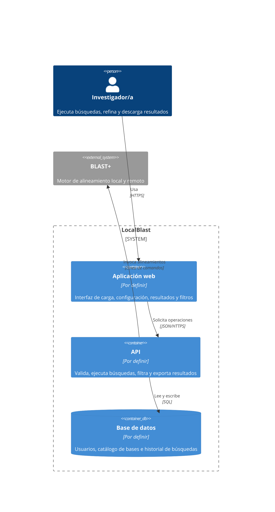
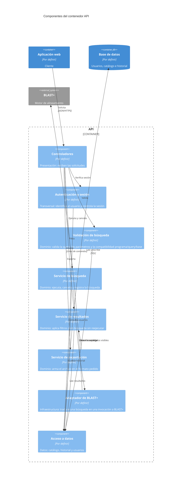

# Documento de Especificación de Arquitectura — LocalBlast

Este documento define la arquitectura de LocalBlast para los procesos de **ejecución de búsqueda BLAST (P1)** y **filtrado y entrega de resultados (P2)**. Representa las decisiones estructurales con las vistas de contenedores y componentes del modelo C4 (Context, Containers, Components, Code), apoyándose en los escenarios de atributo de calidad del sistema para justificar cada decisión.

---

## Índice

1. [Introducción](#1-introducción)
2. [Restricciones](#2-restricciones)
3. [Contexto](#3-contexto)
4. [Drivers arquitectónicos](#4-drivers-arquitectónicos)
5. [Estrategia de solución](#5-estrategia-de-solución)
6. [Vista de contenedores](#6-vista-de-contenedores)
7. [Vistas de componentes](#7-vistas-de-componentes)
8. [Historias de usuario sobre las vistas](#8-historias-de-usuario-sobre-las-vistas)
9. [Decisiones de arquitectura](#9-decisiones-de-arquitectura)
10. [Trazabilidad](#10-trazabilidad)
11. [Glosario](#11-glosario)

---

## 1. Introducción

### 1.1 Propósito

Describir las decisiones estructurales de LocalBlast que atienden los escenarios de calidad críticos del sistema, y representarlas con las vistas de contenedores y componentes del modelo C4. El documento es la línea base arquitectónica para el desarrollo iterativo del sistema.

### 1.2 Alcance

La arquitectura se define para los dos procesos del sistema que se desarrollan en el alcance actual:

- **P1 · Ejecutar búsqueda BLAST** (casos de uso CU001 a CU005).
- **P2 · Filtrar y entregar resultados** (casos de uso CU006 y CU007).

El proceso **P3 · Administrar bases de datos** queda fuera del alcance del cuatrimestre (ver [SRS, sección 1.4](../requeriments/srs.md#14-fuera-del-alcance)); su actor Administrador/a y el flujo de administración del catálogo no se detallan en estas vistas.

Las vistas de clases y de código, y los diagramas de despliegue, no forman parte de este documento: se desarrollarán en una iteración posterior.

### 1.3 Audiencia

- **Equipo de desarrollo** de LocalBlast: usa el documento como guía de construcción.
- **Integrantes futuros** del proyecto: lo consultan al incorporarse para entender rápidamente la estructura del sistema y las razones de cada decisión.

### 1.4 Siglas

Las siglas se definen la primera vez que se usan en el cuerpo del documento. El glosario completo está en la [sección 11](#11-glosario).

---

## 2. Restricciones

| Tipo | Restricción | Cómo condiciona la arquitectura |
|---|---|---|
| **Tecnología externa obligatoria** | BLAST+ (versión 2.14 o posterior) está instalado en el servidor; LocalBlast lo usa, no lo empaqueta ni lo reimplementa | BLAST+ es un sistema externo que se invoca, no un contenedor propio |
| **Técnica** | En modo remoto es BLAST+ quien contacta a NCBI (flag `-remote`); LocalBlast no dialoga con NCBI | No hay relación directa entre LocalBlast y NCBI en los diagramas |
| **Técnica** | El catálogo de bases locales (D1) se puebla por fuera del sistema (P3 fuera de alcance) | El catálogo se lee, no se escribe desde la aplicación |
| **Técnica** | Los usuarios se dan de alta por fuera del sistema; solo hay autenticación básica | La arquitectura incorpora unicamente un aspecto transversal simple de autenticacion (login/logout) para proteger y vincular el historial a cada investigador |
| **Equipo** | El equipo se compone por 3 estudiantes | No se adoptan arquitecturas de alta complejidad operativa |
| **Tiempo** | Duración disponible: un cuatrimestre | Se acota el alcance arquitectonico a los procesos criticos (P1 y P2) |
| **Tecnológica** | Lenguajes y frameworks que el equipo ya domina | El equipo domina lenguajes como Python y bases de datos relacionales. Para el frontend el equipo adopta **React**, con una curva de aprendizaje asumible dentro del cuatrimestre pero tiene tiempo limitado para aprender otras tecnologias o lenguajes completamente nuevos |

---

## 3. Contexto

El diagrama de contexto del sistema, con sus actores humanos (Investigador/a y Administrador/a) y el único sistema externo con el que dialoga (BLAST+), se desarrolla en el documento dedicado del repositorio:

👉 [`contexto-inicial.md`](contexto-inicial.md)

Para el alcance de este documento conviene retener dos aclaraciones del contexto, porque condicionan directamente las decisiones de arquitectura:

- **Local vs. remoto es transparente para LocalBlast.** La diferencia entre modo local y modo remoto queda enteramente del lado de BLAST+: en modo local lee índices del servidor del laboratorio; en modo remoto recibe la flag `-remote` y él mismo dialoga con NCBI. Nuestro sistema no implementa cliente HTTP hacia NCBI. Para LocalBlast, los dos modos son la misma operación —invocar BLAST+ con argumentos distintos— y la arquitectura los trata uniformemente.
- **Procesos profundizados.** Solo P1 y P2 entran en esta arquitectura; el actor Administrador/a y el proceso P3 quedan documentados en el contexto pero no se detallan acá.

---

**Descripción de elementos:**

| Elemento | Tipo | Responsabilidad |
|---|---|---|
| Investigador/a | Persona | Actor que hace uso del sistema |
| LocalBlast | Sistema | Sistema principal que permite la comunicacion con la API |
| BLAST+ | Sistema externo | Sistema encargado de ejecutar los alineamientos locales |

---

## 4. Drivers arquitectónicos

### 4.1 Elección del atributo de calidad como driver

De los cinco atributos de calidad priorizados en el documento de [escenarios de calidad](../requeriments/quality-scenarios/escenarios-calidad.md), elegimos un único atributo como **driver arquitectónico**: **Interoperabilidad** (Compatibilidad / Interoperabilidad en ISO/IEC 25010:2023).

**Por qué este y no otro:**

- **Es condición de existencia del producto.** LocalBlast *es*, por definición, una interfaz gráfica para BLAST+. Toda ejecución —local o remota— termina siendo una invocación al binario externo y un parseo de su salida. Sin interoperabilidad con BLAST+ el sistema no existe; con los otros atributos, LocalBlast puede ser menos ágil, menos robusto o menos modular, pero sigue siendo un sistema.
- **Fue el atributo más crítico en la matriz comparativa**, con 9 victorias sobre 9 posibles. Ningún otro atributo lo venció en ningún par.
- **Es el atributo que más condiciona la estructura.** La elección de cómo invocar a BLAST+, dónde alojar al adaptador, cómo aislar las versiones del binario del resto del código, y cómo manejar la concurrencia de subprocesos son decisiones estructurales. Los otros atributos se materializan sobre todo *dentro* de las piezas que la interoperabilidad obliga a crear:
  - *Operabilidad* se juega en la Aplicación Web (parte del cliente del estilo que vamos a elegir).
  - *Confidencialidad* se resuelve con TLS en el canal cliente-servidor y con el componente **Autenticación y sesión** del API (ver sección 7.1), que acompaña al estilo elegido pero no es un estilo propio.
  - *Tolerancia a fallos* se trata, en nuestro caso, delegando a BLAST+ el reporte de errores remotos y propagándolos sin reinterpretarlos: una responsabilidad del adaptador que la interoperabilidad exige crear.
  - *Modularidad* se obtiene en gran medida como consecuencia del patrón que la interoperabilidad justifica (ver [sección 5.3](#53-patrón-arquitectónico-capas)): aislar BLAST+ en una capa dedicada deja el resto del sistema modular por diseño.

**Qué hacen los otros atributos en esta arquitectura.** No se descartan: se cubren mediante decisiones de implementación y restricciones de desarrollo dentro de los contenedores y componentes que la interoperabilidad justifica. La elección de un único driver es una **decisión de énfasis**, no una renuncia a los otros atributos.

### 4.2 Escenarios seleccionados como drivers

De los dos escenarios de interoperabilidad disponibles, ambos son drivers arquitectónicos: cada uno condiciona la estructura del sistema de un modo distinto.

#### EC-01 · Sobrecarga por concurrencia de invocaciones

| Campo | Contenido |
|---|---|
| **Estímulo** | Hasta cinco investigadores lanzan búsquedas concurrentes contra el sistema, mezclando modo local y remoto. |
| **Respuesta esperada** | Cada búsqueda corre como subproceso independiente de BLAST+; los resultados se entregan a la sesión que los originó, sin cruce con otras. |
| **Medida** | **Cero** cruces de resultados con hasta cinco búsquedas concurrentes. |
| **Por qué condiciona la estructura** | Exige un contenedor servidor capaz de alojar subprocesos independientes de BLAST+ (uno por búsqueda), con un componente dedicado a mantener la correspondencia entre subproceso y sesión del investigador. No se puede resolver dentro de un único componente, ni solo en la interfaz. |

#### EC-02 · Degradado por cambio menor de versión de BLAST+

| Campo | Contenido |
|---|---|
| **Estímulo** | El administrador de sistemas actualiza BLAST+ a una versión posterior que suma columnas o campos a la salida, sin coordinarlo con el equipo de desarrollo. |
| **Respuesta esperada** | El parser reconoce los campos conocidos, ignora los nuevos sin corromper los conocidos, no aborta y registra una advertencia. |
| **Medida** | **100%** de las búsquedas con salida "casi conocida" presentan intactos los campos obligatorios. |
| **Por qué condiciona la estructura** | Exige un componente adaptador aislado entre el núcleo del sistema y BLAST+. Los demás componentes **no deben saber** cómo es la salida real del binario, para que un cambio en esa salida no se propague por todo el código. Es una decisión de dependencia estructural, no de implementación interna. |

La especificación completa de ambos escenarios, con todos sus componentes (fuente del estímulo, estímulo, entorno, artefacto, respuesta, medida), está en la sección 5.1 de [`escenarios-calidad.md`](../requeriments/quality-scenarios/escenarios-calidad.md#51-interoperabilidad).

### 4.3 Restricciones del proyecto que acompañan a los drivers

Dos restricciones de la [sección 2](#2-restricciones) influyen directamente en cómo se traducen estos drivers en estructura:

- **Equipo de 3 personas con dedicación parcial.** Toda alternativa de arquitectura que atienda los drivers debe ser realizable con ese presupuesto. Esto descarta soluciones de alta complejidad operativa aunque sean técnicamente superiores (ver [DA-01](#da-01--estilo-base-cliente-servidor) y [DA-02](#da-02--patrón-capas-en-los-contenedores-con-lógica-propia)).
- **Tecnologías dominadas o adoptables por el equipo.** El estilo elegido se realiza del lado servidor con Python (que el equipo ya domina) y, del lado cliente, con React (que el equipo adopta en el cuatrimestre).

---

## 5. Estrategia de solución

Esta sección recorre, en orden de abstracción decreciente, las decisiones de la arquitectura: tácticas → estilo → patrón → cobertura de los drivers.

### 5.1 Tácticas elegidas y descartadas

Para los dos drivers del punto anterior, las tácticas seleccionadas y descartadas del catálogo de interoperabilidad son:

| Táctica | Decisión | Por qué |
|---|---|---|
| **Adaptar la interfaz** | ✅ Seleccionada | Es la táctica central para EC-02. Un componente dedicado traduce entre la salida real de BLAST+ (texto tabular, XML, código de salida) y la estructura interna del sistema. Si BLAST+ cambia, cambia solo ese componente. |
| **Respetar estándares de comunicación** | ✅ Seleccionada | Entre el navegador y el servidor usamos HTTPS con JSON (web estándar); con BLAST+ usamos la interfaz de línea de comandos estándar documentada en el manual oficial del motor. Nada propietario entre contenedores. |
| **Descubrir servicios** | ❌ Descartada | BLAST+ corre en el mismo servidor que el API, con ruta configurada. No hay universo de servicios por descubrir en tiempo de ejecución. |
| **Orquestar** | ❌ Descartada | No hay varios servicios que orquestar: hay un único sistema externo (BLAST+) invocado por una sola operación por búsqueda. |

**Tácticas de otros atributos adoptadas en apoyo a los drivers de interoperabilidad.** Dos tácticas que pertenecen a otros atributos sostienen el cumplimiento de los drivers:

| Táctica | Atributo origen | Por qué la adoptamos para interoperabilidad |
|---|---|---|
| **Introducir concurrencia** | Desempeño | Es la táctica que atiende el "cero cruces con cinco concurrentes" de EC-01. Lanzar cada búsqueda como subproceso independiente del binario BLAST+, con su propio contexto, es lo que garantiza el aislamiento. |
| **Encapsular** | Modificabilidad | Convierte al adaptador en el único punto de contacto con BLAST+. Es el mecanismo del patrón Capas (ver [sección 5.3](#53-patrón-arquitectónico-capas)) que materializa la táctica "adaptar la interfaz" dentro del contenedor API. |

### 5.2 Estilo arquitectónico base: Cliente-Servidor

**Decisión.** Adoptamos **Cliente-Servidor** como estilo arquitectónico base para todo el sistema (ver [DA-01](#da-01--estilo-base-cliente-servidor)).

**Por qué este estilo:**

- **BLAST+ corre del lado servidor por obligación.** El binario está instalado en el servidor del laboratorio, no en el navegador del investigador. Una vez aceptado que hace falta un servidor, cliente-servidor es la estructura más chica que lo acompaña: un cliente que presenta, un servidor que ejecuta BLAST+ y persiste. Cualquier otro estilo multiplica piezas sin agregar nada que resuelva mejor nuestros drivers.
- **Los dos drivers viven dentro de un único proceso servidor.** EC-01 se resuelve con subprocesos lanzados por el mismo API; EC-02 con un componente del mismo API. Ninguno exige estado distribuido, bus de eventos ni coordinación entre servicios. Un estilo que ofrezca esas capacidades sería un costo operativo pagado por algo que no necesitamos.
- **REST + JSON es el contrato estándar entre cliente y servidor.** Materializa la táctica "respetar estándares de comunicación" en el borde más visible del sistema y mantiene abierta la puerta a un segundo cliente —por ejemplo un script de automatización que un investigador quiera correr— sin tocar el servidor.
- **Permite evolucionar sin rehacer.** Si en el futuro aparece un escenario de procesamiento asincrónico pesado (lotes de 100 búsquedas, por ejemplo), se puede sumar una cola entre el servidor y un ejecutor dedicado sin romper el estilo base: cliente-servidor convive con esa evolución, mientras que elegir hoy un estilo más complejo nos obligaría a sostener su costo *desde el principio*.

**Restricciones del estilo que la arquitectura respeta:**

| Restricción del estilo cliente-servidor | Cómo se respeta en LocalBlast |
|---|---|
| Los clientes no se comunican entre sí | Solo hay un cliente (Aplicación Web); no hay comunicación cliente-cliente. |
| El cliente no accede directamente a la base de datos | La Aplicación Web nunca habla SQL. Todo acceso a datos pasa por el API. |
| El servidor no inicia la comunicación con el cliente | El API responde a las solicitudes del cliente; no empuja mensajes al navegador por iniciativa propia (el progreso de la búsqueda se consulta desde el cliente). |
| El cliente inicia siempre la comunicación | Todas las flechas entre contenedores salen del cliente o del API hacia abajo (BD, BLAST+); ninguna sale de la BD o de BLAST+ hacia el cliente. |

Esto se verifica directamente en la vista de contenedores de la [sección 6](#6-vista-de-contenedores).

**Alternativas consideradas y descartadas:**

| Alternativa | Por qué se descartó |
|---|---|
| **Microservicios** | Exigen complejidad operativa (varios despliegues, red interna, consistencia entre bases) que un equipo de tres personas con dedicación parcial no sostiene. No hay en LocalBlast partes con ritmos de cambio o de escala tan distintos como para justificar el costo. |
| **Orientada a eventos** | Resuelve picos y tareas lentas con desacople asincrónico. Con cinco búsquedas concurrentes y usuarios de un laboratorio chico, el acople síncrono alcanza. Sumar una cola es un contenedor más que operar sin beneficio para los drivers actuales. Queda como opción para una iteración futura si los escenarios cambian. |
| **SOA con bus** | Pensada para integrar sistemas existentes. En LocalBlast hay un único sistema externo (BLAST+) sin ningún bus de por medio y sin otros sistemas con los que integrarse. |

### 5.3 Patrón arquitectónico: Capas

**Decisión.** Adoptamos el **patrón de Capas** dentro de los dos contenedores que alojan lógica propia: la Aplicación Web y el API. El estilo cliente-servidor organiza el sistema entero; el patrón de Capas organiza la lógica interna de cada uno de esos contenedores (ver [DA-02](#da-02--patrón-capas-en-los-contenedores-con-lógica-propia)).

**Por qué este patrón:**

- **Materializa la táctica "adaptar la interfaz" de forma mínima y suficiente.** En el API, pone al adaptador de BLAST+ en la capa de datos, aislado detrás de una interfaz interna estable. Las capas superiores (dominio, presentación) no saben cómo es la salida real del binario; invocan al adaptador por sus métodos. Un cambio en la salida de BLAST+ se absorbe en el adaptador y no se propaga.
- **Cumple con las restricciones del equipo.** Capas es más chico que Hexagonal (puertos y adaptadores) y es el que un equipo de tres personas puede sostener sin sobreingeniería. Hexagonal también funcionaría —y queda como opción si el proyecto crece— pero introduce más piezas (puertos explícitos, inversión de dependencias) que no son necesarias para los drivers actuales.
- **Permite replicar la misma mentalidad en el cliente.** La Aplicación Web también tiene lógica interna (validaciones, orquestación del formulario, llamadas al servidor); organizarla por capas la hace evolucionar al mismo ritmo que el servidor, con un modelo mental consistente.
- **Satisface tácticas de modificabilidad por diseño.** Separar en capas con dependencias hacia abajo mejora modularidad y capacidad de prueba.

**Las tres capas, aplicadas en cada contenedor:**

| Capa | En la Aplicación Web | En el API |
|---|---|---|
| **Presentación** | Pantallas que ve el investigador (carga, configuración, resultados, descarga). Componente: **Pantallas**. | Borde HTTP del servidor: recibe solicitudes, valida sintácticamente las entradas, serializa respuestas, devuelve códigos de estado. Componente: **Controladores**. |
| **Dominio** | Lógica de aplicación del cliente: valida formato de secuencia, rangos de parámetros y compatibilidad programa-query-base **antes** de pedir el envío al servidor. Componente: **Validación y envío**. | Lógica del dominio del servidor. Tres componentes para las fases del ciclo de la búsqueda —antes de BLAST+, durante y después— más un componente para la identidad del investigador, que es parte del dominio porque el historial se corresponde a cada uno. Componentes: **Autenticación y sesión**, **Preparación de búsqueda**, **Ejecución y persistencia**, **Entrega de resultados**. |
| **Datos** | Acceso al mundo exterior del cliente (que para el cliente es el API). Componente: **Cliente del API**. | Acceso al mundo exterior del servidor: la base de datos y el binario BLAST+. Componentes: **Acceso a datos**, **Adaptador BLAST+**. |

**Validación en el cliente, además de en el servidor.** La capa de dominio de la Aplicación Web aloja la validación del formulario antes de enviar la configuración al servidor. Esta decisión se documenta aparte en [DA-05](#da-05--validación-en-la-aplicación-web-además-de-en-el-servidor): el cliente valida para que el investigador reciba feedback inmediato y para reducir solicitudes al servidor por configuraciones mal armadas; el servidor **repite** la validación completa sobre todo lo que recibe, porque la validación del cliente puede ser salteada por un actor malicioso y, por lo tanto, no es un control de seguridad.

**Restricciones del patrón que la arquitectura respeta en ambos contenedores:**

| Restricción del patrón de Capas | Cómo se respeta |
|---|---|
| Una capa no depende de las superiores | En el API, ningún componente de dominio llama a los Controladores; ningún componente de datos llama a los de dominio ni a los Controladores. En la Aplicación Web, el Cliente del API no llama a Validación y envío, y Validación y envío no llama a Pantallas. |
| Cada capa usa solo a la inmediatamente inferior | En el API: Controladores → componentes de dominio → Acceso a datos / Adaptador BLAST+. En la Aplicación Web: Pantallas → Validación y envío → Cliente del API. |
| Cada capa tiene una responsabilidad clara | Ver la tabla de capas más arriba. Ninguna capa mezcla responsabilidades que correspondan a otra. |

Esto se verifica directamente en las vistas de componentes de la [sección 7](#7-vistas-de-componentes): todas las flechas entre capas van en la misma dirección.

**Alternativas consideradas y descartadas:**

| Alternativa | Por qué se descartó |
|---|---|
| **Hexagonal (puertos y adaptadores)** | Aísla más estrictamente, pero con un único sistema externo (BLAST+) las piezas extra (puertos explícitos, inversión de dependencias) son sobreingeniería para un equipo de 3 personas. Capas cubre nuestras necesidades con menos piezas. |
| **MVC** | Está pensado para separar presentación, lógica de interacción y modelo en una interfaz. Capas es más general y permite aplicar la misma mentalidad tanto en el cliente como en el servidor, cosa que MVC no cubre con la misma naturalidad. |
| **Broker** | Resuelve desacoplar emisores y receptores con un intermediario de mensajes. En LocalBlast, el API y el adaptador de BLAST+ viven en el mismo proceso: una cola de mensajes sería un contenedor más que operar sin beneficio. |

### 5.4 Aspectos transversales

Los aspectos transversales habituales en una arquitectura de este estilo —auditoría, gestión de excepciones, instrumentación— **no forman parte de esta entrega del documento de arquitectura**. Se incorporarán en una iteración posterior, cuando el sistema entre en una etapa en la que esas responsabilidades se vuelvan parte del alcance de desarrollo.

**La autenticación y gestión de sesión sí se modela, pero no como aspecto transversal**: se la trata como un componente de dominio propio en el API (**Autenticación y sesión**, visible en la [sección 7.1](#71-vista-de-componentes-del-api)). La razón es que en LocalBlast la identidad del investigador no es solo un chequeo invisible al código: el historial de búsquedas se corresponde a cada investigador y esa correspondencia es parte del dominio del sistema, no un detalle de infraestructura. Modelarla como componente la vuelve explícita y permite trazar cómo cada efecto sobre la base de datos queda asociado al investigador correcto.

### 5.5 Tabla de cobertura

Cómo la arquitectura cubre cada driver y qué sacrifica a cambio.

| Driver | Táctica(s) | Dónde se materializa en la arquitectura | Qué se sacrifica |
|---|---|---|---|
| **EC-01** · Hasta cinco invocaciones concurrentes a BLAST+ sin cruce de resultados | Introducir concurrencia + encapsular | Componente **Adaptador BLAST+** del API: cada invocación corre como subproceso independiente, con identificador propio y referencia a la sesión que la lanzó (ver [DA-04](#da-04--ejecutar-cada-búsqueda-como-subproceso-independiente-de-blast)). | Mayor consumo de CPU y memoria durante los picos de concurrencia (un proceso de BLAST+ por búsqueda). Aceptable en un laboratorio chico. |
| **EC-02** · Cambios menores de versión de BLAST+ sin romper el parseo de la salida | Adaptar la interfaz + encapsular | Componente **Adaptador BLAST+** del API: su parser reconoce los campos conocidos por nombre, ignora los no mapeados y descarta sin corromper los conocidos. El resto del sistema no cambia (ver [DA-03](#da-03--adaptador-blast-como-componente-dedicado-en-la-capa-de-datos)). | El equipo debe sostener el mapeo "campo de BLAST+ → entidad del dominio" al día en el adaptador cuando el motor evoluciona. Es un costo operativo bajo. |

**Conflictos entre tácticas: verificación.** Ninguna de las tácticas que adoptamos entra en conflicto con las demás. Encapsular el acceso a BLAST+ mejora modularidad y, al mismo tiempo, es lo que permite el aislamiento de concurrencia (cada subproceso lo lanza el mismo componente, con su propia correspondencia a la sesión). Respetar estándares de comunicación con el cliente (REST + JSON) no interfiere con el canal CLI hacia BLAST+ (son dos interfaces distintas, una por cada relación entre contenedores).

---
## 6. Vista de contenedores

<!-- Reglas (secc. 4.4 del enunciado):
     - Una sola vista global, con título.
     - Dentro del límite del sistema solo contenedores; personas y sistemas externos van afuera.
     - Cada contenedor: nombre (rol, sin tecnología), tecnología y responsabilidad en una frase.
     - Bases de datos y colas son contenedores.
     - Un contenedor no contiene otros contenedores ni componentes.
     - Sin elementos aislados. Máximo aproximado: 10 elementos.
     - Flechas desde quien inicia, con verbo y protocolo; sin flecha de respuesta. -->

### 6.1 Diagrama (versión actual)

<!-- Punto de partida: cliente-servidor. Evolucionar con cada driver (ver 6.4).
     Reemplazar "Por definir" por la tecnología real. -->

<!-- Variante candidata si un driver (por ejemplo, tolerancia a fallos o ejecución asíncrona con cancelación)
     exige desacoplar la ejecución de la búsqueda: agregar una cola y un proceso separado.
     Solo se incorpora si queda justificada por una decisión DA-xx.

     ContainerQueue(cola, "Cola de búsquedas", "Por definir", "Solicitudes de búsqueda pendientes")
     Container(ejecutor, "Ejecutor de búsquedas", "Por definir", "Toma solicitudes, invoca BLAST+ y guarda resultados")
     Rel(api, cola, "Publica solicitudes", "AMQP")
     Rel(ejecutor, cola, "Consume solicitudes", "AMQP")
     Rel(ejecutor, bd, "Guarda resultados", "SQL")
     Rel(ejecutor, blast, "Invoca alineamientos", "Línea de comandos")
-->

### 6.2 Catálogo de contenedores

| Contenedor | Tecnología | Responsabilidad |
|---|---|---|
| Aplicación web | [...] | [...] |
| API | [...] | [...] |
| Base de datos | [...] | [...] |

### 6.3 Catálogo de relaciones

| Origen | Destino | Qué se comunica | Tipo | Protocolo |
|---|---|---|---|---|
| Investigador/a | Aplicación web | Uso de la interfaz | Persona hacia contenedor | HTTPS |
| Aplicación web | API | [...] | Síncrona | [...] |
| API | Base de datos | [...] | Acceso a datos | [...] |
| API | BLAST+ | [...] | Integración externa | [...] |

### 6.4 Evolución de la vista

<!-- Cada cambio significativo en la vista es una decisión de arquitectura (DA-xx). -->

| Versión | Driver | Decisión | Qué cambia en las vistas |
|---|---|---|---|
| v0 | Punto de partida | [Estilo base y patrón inicial] | [Contenedores iniciales] |
| v1 | `EC-xx` | `DA-xx` | [...] |
| v2 | `EC-xx` | `DA-xx` | [...] |

---

## 7. Vista de componentes

<!-- Una vista por cada contenedor que implementa P1 y P2 y tiene lógica propia.
     No se hace para bases de datos ni colas.
     Reglas (secc. 4.5 del enunciado):
     - Los componentes van dentro del límite de ese contenedor; lo externo va afuera sin sus componentes.
     - Un componente pertenece a un solo contenedor y no contiene otros componentes.
     - No son clases: son agrupaciones coherentes de funcionalidad.
     - Respetar las restricciones de los patrones elegidos (por ejemplo, en capas las dependencias van hacia abajo).
     - Los aspectos transversales adoptados se dibujan como componentes propios.
     - Sin componentes huérfanos: cada uno se rastrea a una HU, un RF o una DA.
     - Entre componentes la relación es una llamada interna: verbo, sin protocolo. -->

### 7.1 Contenedor API

#### Diagrama (versión actual)

<!-- Propuesta inicial a validar: capas + puerto/adaptador hacia BLAST+ (si se adopta el patrón hexagonal). -->

#### Catálogo de componentes

| Componente | Tecnología | Responsabilidad | Se rastrea a |
|---|---|---|---|
| Controladores | [...] | Reciben las solicitudes de la aplicación web | [RF / HU / DA] |
| Autenticación y sesión | [...] | [...] | [...] |
| Validación de búsqueda | [...] | [...] | RF-02, RF-05, RF-07 |
| Servicio de búsqueda | [...] | [...] | RF-03, RF-08, RF-10 |
| Servicio de resultados | [...] | [...] | RF-09, RF-11 |
| Servicio de exportación | [...] | [...] | RF-12 |
| Adaptador de BLAST+ | [...] | [...] | RF-03 |
| Acceso a datos | [...] | [...] | RF-10 |

#### Catálogo de relaciones

<!-- Entre componentes del mismo contenedor el tipo es "llamada interna" y no lleva protocolo. -->

| Origen | Destino | Qué se comunica | Tipo | Protocolo |
|---|---|---|---|---|
| Controladores | Autenticación y sesión | Verificación de sesión | Llamada interna | — |
| [...] | [...] | [...] | Llamada interna | — |

### 7.2 Otros contenedores

<!-- Agregar una subsección por cada contenedor que implemente P1 o P2 y tenga lógica propia
     (por ejemplo, el Ejecutor de búsquedas, si se incorpora, o la Aplicación web si el patrón
     MVC o MVVM aporta valor). Si no hay ninguno más, escribir "No aplica". -->

---

## 8. Historias de usuario sobre las vistas

<!-- Tomar cada HU de P1 y P2 y ubicar cada paso del Given-When-Then en un contenedor y en un componente.
     Si un paso no tiene dónde ocurrir, falta un contenedor, un componente o una relación. -->

| Historia de usuario | Paso del criterio de aceptación | Contenedores | Componentes |
|---|---|---|---|
| `HU[xx]_CU00[x]_[slice]` [nombre] | Given [...], When [...], Then [...] | [Aplicación web → API → Base de datos] | [Controladores → ... → Acceso a datos] |
| `HU[xx]_CU00[x]_[slice]` [nombre] | [...] | [...] | [...] |

---

## 9. Decisiones de arquitectura

<!-- Una entrada por decisión significativa. Cada driver debe tener al menos una decisión.
     Copiar la plantilla para cada nueva decisión. -->

### DA-01 — [Título corto de la decisión]

- **Escenario que la motiva:** [EC-xx y breve descripción]
- **Contexto:** [Qué problema o tensión hay que resolver y qué restricciones existen]
- **Decisión:**
  - Tácticas: [nombre y atributo, según la Tabla 2]
  - Estilo: [estilo base, o estilo aplicado a una parte del sistema, indicando cuál]
  - Patrón: [patrón aplicado y en qué contenedor, si corresponde]
- **Alternativas consideradas:**
  - [Alternativa 1] — descartada porque [motivo].
  - [Alternativa 2] — descartada porque [motivo].
- **Consecuencias:**
  - A favor: [atributos que mejoran]
  - En contra: [atributos que se sacrifican, costos, riesgos]
- **Elementos afectados:** [contenedores o componentes que crea o modifica]

### DA-02 — [Título corto de la decisión]

[Misma plantilla.]

---

## 10. Trazabilidad

### 10.1 Escenario → táctica → estilo o patrón → decisión → elemento C4

| Escenario (TP2) | Atributo | Tácticas | Estilo o patrón | Decisión | Elemento C4 |
|---|---|---|---|---|---|
| `EC-01` | [...] | [...] | [...] | `DA-01` | [Contenedor o componente] |
| `EC-02` | [...] | [...] | [...] | `DA-02` | [...] |

### 10.2 Historia de usuario → elementos C4

| Historia de usuario | Contenedores | Componentes |
|---|---|---|
| `HU[xx]_CU00[x]_[slice]` | [...] | [...] |

### 10.3 Contenedor o componente → responsabilidad de origen

<!-- Ningún elemento puede quedar sin origen: debe venir de un RF, una HU o una DA. -->

| Elemento | Tipo | Origen (RF / HU / DA) |
|---|---|---|
| [...] | [Contenedor / Componente] | [...] |

---

## 11. Glosario y bibliografía

### 11.1 Glosario

| Término | Significado |
|---|---|
| Contenedor | Aplicación o almacén de datos que se ejecuta por separado |
| Componente | Agrupación coherente de funcionalidad dentro de un contenedor |
| Driver arquitectónico | Escenario de calidad que condiciona la estructura del sistema |
| [...] | [...] |

### 11.2 Bibliografía

- Bass, L., Clements, P. y Kazman, R. *Software Architecture in Practice*. Addison-Wesley.
- ISO/IEC 25010:2023. *Systems and software Quality Requirements and Evaluation (SQuaRE) — Product quality model*.
- Brown, S. El modelo C4 para visualizar la arquitectura de software.
- arc42. Plantilla de documentación de arquitectura.
- [Material teórico de la materia sobre arquitectura de software]

---

## Checklist antes del Pull Request

<!-- Borrar esta sección al entregar. -->

- [ ] El contexto coincide con el DFD Nivel 0 del TP1.
- [ ] Todos los diagramas están en Mermaid, dentro del `.md`, sin imágenes pegadas.
- [ ] Cada driver tiene tácticas, al menos una DA y un elemento C4.
- [ ] El estilo y los patrones declarados coinciden con lo que muestran las vistas.
- [ ] Los contenedores de la vista de componentes son los mismos de la vista de contenedores.
- [ ] Cada elemento se llama igual en las vistas, en las DA y en la trazabilidad.
- [ ] No hay vistas de clases, de código ni de despliegue.
- [ ] Las siglas están aclaradas la primera vez que se usan.
- [ ] El registro de uso de IA está en `docs/uso-ia.md`.
