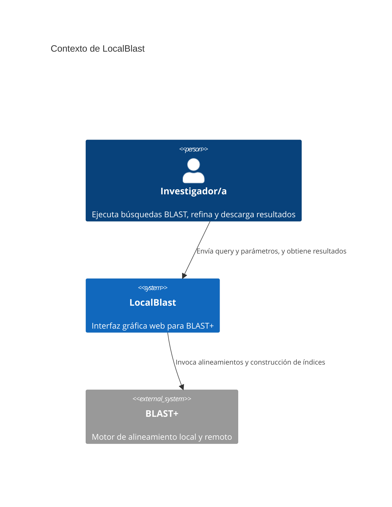
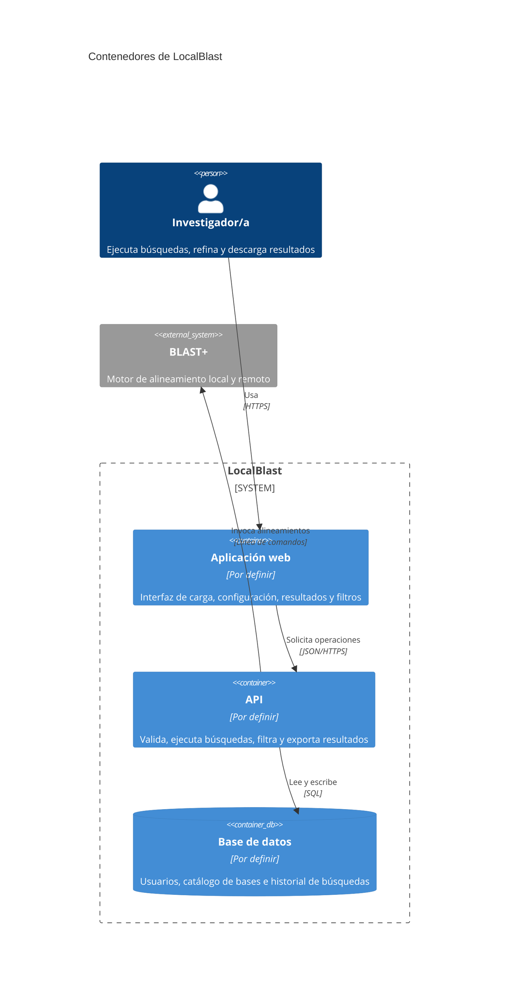
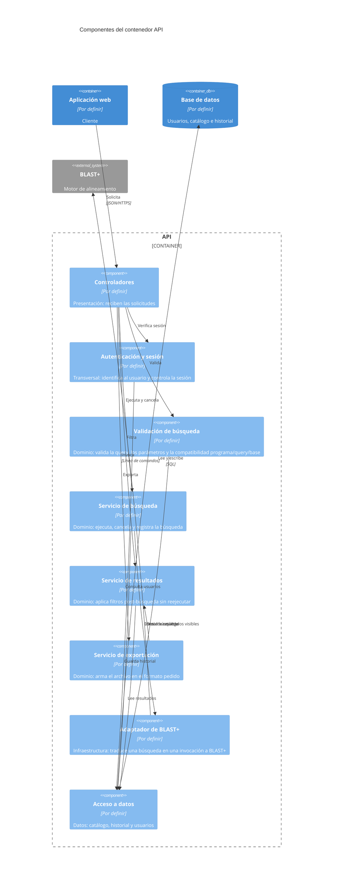

# Documento de Especificación de Arquitectura — LocalBlast

## Índice

1. [Introducción](#1-introducción)
2. [Restricciones](#2-restricciones)
3. [Contexto](#3-contexto)
4. [Drivers arquitectónicos](#4-drivers-arquitectónicos)
5. [Estrategia de solución](#5-estrategia-de-solución)
6. [Vista de contenedores](#6-vista-de-contenedores)
7. [Vista de componentes](#7-vista-de-componentes)
8. [Historias de usuario sobre las vistas](#8-historias-de-usuario-sobre-las-vistas)
9. [Decisiones de arquitectura](#9-decisiones-de-arquitectura)
10. [Trazabilidad](#10-trazabilidad)
11. [Glosario y bibliografía](#11-glosario-y-bibliografía)

---

## 1. Introducción

### 1.1 Propósito

Este documento describe la arquitectura de LocalBlast, una interfaz gráfica web para BLAST+. Tiene la funcion de registrar y justificar las decisiones de diseño estructural de un sistema de software, especificando como se organiza el sistema a gran escala y por qué se eligió esa estructura frente a otras alternativas. 

### 1.2 Alcance

- **Procesos con arquitectura detallada:** P1 (Ejecutar búsqueda BLAST) y P2 (Filtrar y entregar resultados), tal como se eligieron en el SRS (sección 5).
- **Caja negra:** P3 (Administrar bases de datos). Se representa como parte del contexto y no se detalla internamente.
- **Fuera de este TP:** Vistas de clases y de código.

### 1.3 Audiencia

Este documento arquitectonico esta dirigido a los miembros del equipo de desarrollo y a la catedra Ing. de Software.

### 1.4 Documentos relacionados

- [SRS](docs/requeriments/srs.md)
- [Contexto inicial (DFD Nivel 0 y 1)](docs/architecture/contexto-inicial.md)
- [Escenarios de calidad](docs/requeriments/quality-scenarios/escenarios-calidad.md)
- [Registro de uso de IA](docs/uso-ia.md)

### 1.5 Siglas usadas

<!-- Aclarar cada sigla la primera vez que aparece en el documento. Esta tabla las reúne. -->

| Sigla | Significado |
|---|---|
| C4 | Modelo de documentación de arquitectura en cuatro niveles: contexto, contenedores, componentes y código |
| DA | Decisión de arquitectura |
| EC | Escenario de calidad |
| HU | Historia de usuario |
| RF | Requerimiento funcional |

---

## 2. Restricciones

| Tipo | Restricción | Cómo condiciona la arquitectura |
|---|---|---|
| Técnica | BLAST+ (versión 2.14 o posterior) está instalado en el servidor; LocalBlast lo usa, no lo empaqueta ni lo reimplementa | [BLAST+ es un sistema externo que se invoca, no un contenedor propio] |
| Técnica | En modo remoto es BLAST+ quien contacta a NCBI (flag `-remote`); LocalBlast no dialoga con NCBI | [No hay relación directa entre LocalBlast y NCBI en los diagramas] |
| Técnica | El catálogo de bases locales (D1) se puebla por fuera del sistema (P3 fuera de alcance) | [El catálogo se lee, no se escribe desde la aplicación] |
| Técnica | Los usuarios se dan de alta por fuera del sistema; solo hay autenticación básica | [...] |
| Equipo | [Cantidad de integrantes y roles] | [...] |
| Tiempo | [Duración disponible: un cuatrimestre] | [...] |
| Tecnológica | [Lenguajes y frameworks que el equipo ya domina] | [...] |

---

## 3. Contexto

<!-- Debe ser coherente con el DFD Nivel 0 del TP1: mismos actores y mismas entidades externas. -->

**Descripción de elementos:**

| Elemento | Tipo | Responsabilidad |
|---|---|---|
| Investigador/a | Persona | [...] |
| Administrador/a | Persona | [...] |
| LocalBlast | Sistema | [...] |
| BLAST+ | Sistema externo | [...] |

---

## 4. Drivers arquitectónicos

<!-- Partir de los escenarios del TP2 y asignarles identificador EC-01, EC-02, etc.
     No todo escenario es driver: solo los que condicionan la estructura
     (estilo, división en contenedores o componentes, colas, réplicas, transacciones).
     Los atributos ya elegidos en el SRS son: Interoperabilidad, Operabilidad,
     Confidencialidad, Tolerancia a fallos y Modularidad. -->

### 4.1 Atributos elegidos y su correspondencia

| Atributo (ISO/IEC 25010:2023) | Atributo del libro (Tabla 1 del TP3) |
|---|---|
| Interoperabilidad | Interoperabilidad |
| Operabilidad | Usabilidad |
| Confidencialidad | Seguridad |
| Tolerancia a fallos | Disponibilidad |
| Modularidad | Modificabilidad |

### 4.2 Escenarios y selección de drivers

| ID | Atributo | Resumen del escenario (estímulo → respuesta) | Medida de respuesta | ¿Es driver? | Por qué condiciona (o no) la estructura |
|---|---|---|---|---|---|
| `EC-01` | [...] | [...] | [...] | [Sí / No] | [...] |
| `EC-02` | [...] | [...] | [...] | [Sí / No] | [...] |
| `EC-03` | [...] | [...] | [...] | [Sí / No] | [...] |
| `EC-04` | [...] | [...] | [...] | [Sí / No] | [...] |
| [...] | [...] | [...] | [...] | [...] | [...] |

---

## 5. Estrategia de solución

### 5.1 Tácticas por driver

<!-- Una táctica es una decisión de diseño, no una tecnología. Usar los nombres de la Tabla 2 del enunciado.
     Si se propone una táctica que no está en la tabla, aclararlo. -->

| Driver | Atributo del libro | Tácticas elegidas y cómo contribuyen | Tácticas descartadas y por qué |
|---|---|---|---|
| `EC-01` | [...] | [...] | [...] |
| `EC-02` | [...] | [...] | [...] |

### 5.2 Estilo base

- **Estilo elegido:** [por ejemplo, cliente-servidor]
- **Por qué:** [qué escenarios y restricciones lo justifican]
- **Qué sacrifica:** [por ejemplo, el servidor es punto único de falla]
- **Comprobación de restricciones (Tabla 4):**

| Restricción o regla del estilo | ¿Se cumple? | Dónde se ve en el diagrama |
|---|---|---|
| [...] | [Sí / No] | [...] |

### 5.3 Estilos adicionales por zona

<!-- Solo si un escenario lo exige. Indicar qué zona del sistema y por qué. Si no hay, escribir "No se adoptan". -->

| Estilo | Zona donde aplica | Escenario que lo exige | Qué sacrifica |
|---|---|---|---|
| [...] | [...] | `EC-xx` | [...] |

### 5.4 Patrones por contenedor

| Contenedor | Patrón | Problema que resuelve | Qué sacrifica | Comprobación de restricciones (Tabla 6) |
|---|---|---|---|---|
| API | [por ejemplo, capas] | [...] | [...] | [...] |
| [...] | [...] | [...] | [...] | [...] |

### 5.5 Aspectos transversales

| Aspecto | ¿Adoptado? | Motivo | Dónde se ve |
|---|---|---|---|
| Autenticación y autorización | [Sí / No] | [...] | [...] |
| Auditoría | [Sí / No] | [...] | [...] |
| Gestión de excepciones | [Sí / No] | [...] | [...] |
| Instrumentación (monitoreo) | [Sí / No] | [...] | [...] |
| Interoperabilidad (estándares) | [Sí / No] | [...] | [...] |
| Notificaciones | [Sí / No] | [...] | [...] |

### 5.6 Tabla de cobertura y sacrificios

| Driver | Cómo lo cubre la arquitectura | Qué se sacrifica |
|---|---|---|
| `EC-01` | [...] | [...] |
| `EC-02` | [...] | [...] |

### 5.7 Conflictos entre tácticas

<!-- Verificar que las tácticas de escenarios distintos no se contradigan. -->

| Tácticas en tensión | Escenarios | Cómo se resolvió |
|---|---|---|
| [...] | `EC-xx` / `EC-yy` | [...] |

---

## 6. Vista de contenedores

<!-- Reglas (secc. 4.4 del enunciado):
     - Una sola vista global, con título.
     - Dentro del límite del sistema solo contenedores; personas y sistemas externos van afuera.
     - Cada contenedor: nombre (rol, sin tecnología), tecnología y responsabilidad en una frase.
     - Bases de datos y colas son contenedores.
     - Un contenedor no contiene otros contenedores ni componentes.
     - Sin elementos aislados. Máximo aproximado: 10 elementos.
     - Flechas desde quien inicia, con verbo y protocolo; sin flecha de respuesta. -->

### 6.1 Diagrama (versión actual)

<!-- Punto de partida: cliente-servidor. Evolucionar con cada driver (ver 6.4).
     Reemplazar "Por definir" por la tecnología real. -->

<!-- Variante candidata si un driver (por ejemplo, tolerancia a fallos o ejecución asíncrona con cancelación)
     exige desacoplar la ejecución de la búsqueda: agregar una cola y un proceso separado.
     Solo se incorpora si queda justificada por una decisión DA-xx.

     ContainerQueue(cola, "Cola de búsquedas", "Por definir", "Solicitudes de búsqueda pendientes")
     Container(ejecutor, "Ejecutor de búsquedas", "Por definir", "Toma solicitudes, invoca BLAST+ y guarda resultados")
     Rel(api, cola, "Publica solicitudes", "AMQP")
     Rel(ejecutor, cola, "Consume solicitudes", "AMQP")
     Rel(ejecutor, bd, "Guarda resultados", "SQL")
     Rel(ejecutor, blast, "Invoca alineamientos", "Línea de comandos")
-->

### 6.2 Catálogo de contenedores

| Contenedor | Tecnología | Responsabilidad |
|---|---|---|
| Aplicación web | [...] | [...] |
| API | [...] | [...] |
| Base de datos | [...] | [...] |

### 6.3 Catálogo de relaciones

| Origen | Destino | Qué se comunica | Tipo | Protocolo |
|---|---|---|---|---|
| Investigador/a | Aplicación web | Uso de la interfaz | Persona hacia contenedor | HTTPS |
| Aplicación web | API | [...] | Síncrona | [...] |
| API | Base de datos | [...] | Acceso a datos | [...] |
| API | BLAST+ | [...] | Integración externa | [...] |

### 6.4 Evolución de la vista

<!-- Cada cambio significativo en la vista es una decisión de arquitectura (DA-xx). -->

| Versión | Driver | Decisión | Qué cambia en las vistas |
|---|---|---|---|
| v0 | Punto de partida | [Estilo base y patrón inicial] | [Contenedores iniciales] |
| v1 | `EC-xx` | `DA-xx` | [...] |
| v2 | `EC-xx` | `DA-xx` | [...] |

---

## 7. Vista de componentes

<!-- Una vista por cada contenedor que implementa P1 y P2 y tiene lógica propia.
     No se hace para bases de datos ni colas.
     Reglas (secc. 4.5 del enunciado):
     - Los componentes van dentro del límite de ese contenedor; lo externo va afuera sin sus componentes.
     - Un componente pertenece a un solo contenedor y no contiene otros componentes.
     - No son clases: son agrupaciones coherentes de funcionalidad.
     - Respetar las restricciones de los patrones elegidos (por ejemplo, en capas las dependencias van hacia abajo).
     - Los aspectos transversales adoptados se dibujan como componentes propios.
     - Sin componentes huérfanos: cada uno se rastrea a una HU, un RF o una DA.
     - Entre componentes la relación es una llamada interna: verbo, sin protocolo. -->

### 7.1 Contenedor API

#### Diagrama (versión actual)

<!-- Propuesta inicial a validar: capas + puerto/adaptador hacia BLAST+ (si se adopta el patrón hexagonal). -->

#### Catálogo de componentes

| Componente | Tecnología | Responsabilidad | Se rastrea a |
|---|---|---|---|
| Controladores | [...] | Reciben las solicitudes de la aplicación web | [RF / HU / DA] |
| Autenticación y sesión | [...] | [...] | [...] |
| Validación de búsqueda | [...] | [...] | RF-02, RF-05, RF-07 |
| Servicio de búsqueda | [...] | [...] | RF-03, RF-08, RF-10 |
| Servicio de resultados | [...] | [...] | RF-09, RF-11 |
| Servicio de exportación | [...] | [...] | RF-12 |
| Adaptador de BLAST+ | [...] | [...] | RF-03 |
| Acceso a datos | [...] | [...] | RF-10 |

#### Catálogo de relaciones

<!-- Entre componentes del mismo contenedor el tipo es "llamada interna" y no lleva protocolo. -->

| Origen | Destino | Qué se comunica | Tipo | Protocolo |
|---|---|---|---|---|
| Controladores | Autenticación y sesión | Verificación de sesión | Llamada interna | — |
| [...] | [...] | [...] | Llamada interna | — |

### 7.2 Otros contenedores

<!-- Agregar una subsección por cada contenedor que implemente P1 o P2 y tenga lógica propia
     (por ejemplo, el Ejecutor de búsquedas, si se incorpora, o la Aplicación web si el patrón
     MVC o MVVM aporta valor). Si no hay ninguno más, escribir "No aplica". -->

---

## 8. Historias de usuario sobre las vistas

<!-- Tomar cada HU de P1 y P2 y ubicar cada paso del Given-When-Then en un contenedor y en un componente.
     Si un paso no tiene dónde ocurrir, falta un contenedor, un componente o una relación. -->

| Historia de usuario | Paso del criterio de aceptación | Contenedores | Componentes |
|---|---|---|---|
| `HU[xx]_CU00[x]_[slice]` [nombre] | Given [...], When [...], Then [...] | [Aplicación web → API → Base de datos] | [Controladores → ... → Acceso a datos] |
| `HU[xx]_CU00[x]_[slice]` [nombre] | [...] | [...] | [...] |

---

## 9. Decisiones de arquitectura

<!-- Una entrada por decisión significativa. Cada driver debe tener al menos una decisión.
     Copiar la plantilla para cada nueva decisión. -->

### DA-01 — [Título corto de la decisión]

- **Escenario que la motiva:** [EC-xx y breve descripción]
- **Contexto:** [Qué problema o tensión hay que resolver y qué restricciones existen]
- **Decisión:**
  - Tácticas: [nombre y atributo, según la Tabla 2]
  - Estilo: [estilo base, o estilo aplicado a una parte del sistema, indicando cuál]
  - Patrón: [patrón aplicado y en qué contenedor, si corresponde]
- **Alternativas consideradas:**
  - [Alternativa 1] — descartada porque [motivo].
  - [Alternativa 2] — descartada porque [motivo].
- **Consecuencias:**
  - A favor: [atributos que mejoran]
  - En contra: [atributos que se sacrifican, costos, riesgos]
- **Elementos afectados:** [contenedores o componentes que crea o modifica]

### DA-02 — [Título corto de la decisión]

[Misma plantilla.]

---

## 10. Trazabilidad

### 10.1 Escenario → táctica → estilo o patrón → decisión → elemento C4

| Escenario (TP2) | Atributo | Tácticas | Estilo o patrón | Decisión | Elemento C4 |
|---|---|---|---|---|---|
| `EC-01` | [...] | [...] | [...] | `DA-01` | [Contenedor o componente] |
| `EC-02` | [...] | [...] | [...] | `DA-02` | [...] |

### 10.2 Historia de usuario → elementos C4

| Historia de usuario | Contenedores | Componentes |
|---|---|---|
| `HU[xx]_CU00[x]_[slice]` | [...] | [...] |

### 10.3 Contenedor o componente → responsabilidad de origen

<!-- Ningún elemento puede quedar sin origen: debe venir de un RF, una HU o una DA. -->

| Elemento | Tipo | Origen (RF / HU / DA) |
|---|---|---|
| [...] | [Contenedor / Componente] | [...] |

---

## 11. Glosario y bibliografía

### 11.1 Glosario

| Término | Significado |
|---|---|
| Contenedor | Aplicación o almacén de datos que se ejecuta por separado |
| Componente | Agrupación coherente de funcionalidad dentro de un contenedor |
| Driver arquitectónico | Escenario de calidad que condiciona la estructura del sistema |
| [...] | [...] |

### 11.2 Bibliografía

- Bass, L., Clements, P. y Kazman, R. *Software Architecture in Practice*. Addison-Wesley.
- ISO/IEC 25010:2023. *Systems and software Quality Requirements and Evaluation (SQuaRE) — Product quality model*.
- Brown, S. El modelo C4 para visualizar la arquitectura de software.
- arc42. Plantilla de documentación de arquitectura.
- [Material teórico de la materia sobre arquitectura de software]

---

## Checklist antes del Pull Request

<!-- Borrar esta sección al entregar. -->

- [ ] El contexto coincide con el DFD Nivel 0 del TP1.
- [ ] Todos los diagramas están en Mermaid, dentro del `.md`, sin imágenes pegadas.
- [ ] Cada driver tiene tácticas, al menos una DA y un elemento C4.
- [ ] El estilo y los patrones declarados coinciden con lo que muestran las vistas.
- [ ] Los contenedores de la vista de componentes son los mismos de la vista de contenedores.
- [ ] Cada elemento se llama igual en las vistas, en las DA y en la trazabilidad.
- [ ] No hay vistas de clases, de código ni de despliegue.
- [ ] Las siglas están aclaradas la primera vez que se usan.
- [ ] El registro de uso de IA está en `docs/uso-ia.md`.
