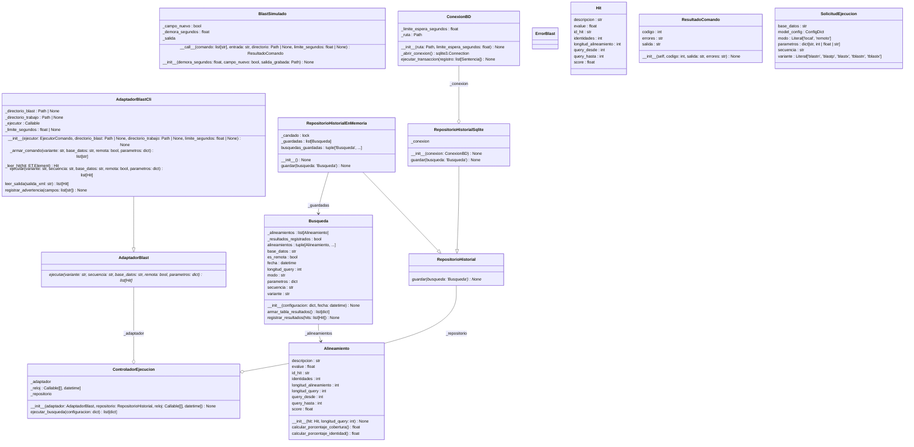

# Diagrama de clases del Backend generado con pyreverse

Salida de `pyreverse` (pylint) sobre `src/backend`, tal como la genera la herramienta. Solo se quitaron tres clases de librerías de terceros (`BaseModel` y `ConfigDict` de pydantic, `TypedDict` de typing), que no son parte del diseño. El diagrama limpio y revisado está en la [sección 4 del diseño detallado](diseno-detallado.md#4-modelo-de-clases).

Comando, desde la raíz del repositorio (requiere `pip install pylint`):

```bash
PYTHONPATH=src pyreverse -o mmd -p LocalBlast --filter-mode ALL -a 0 -s 0 src/backend
```


