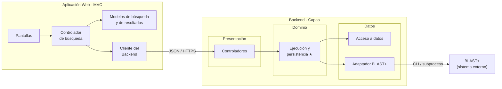
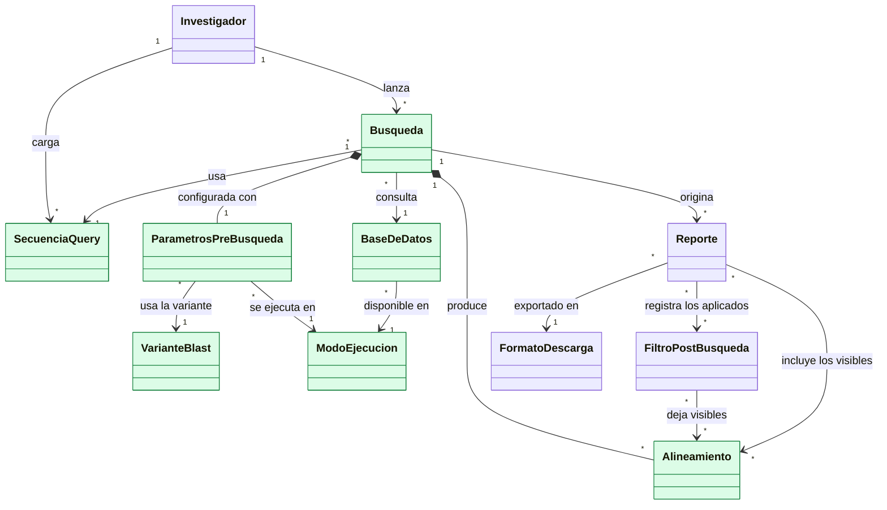
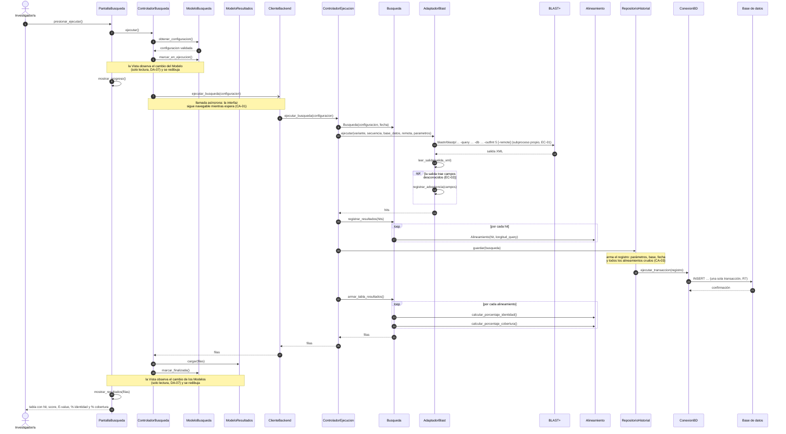
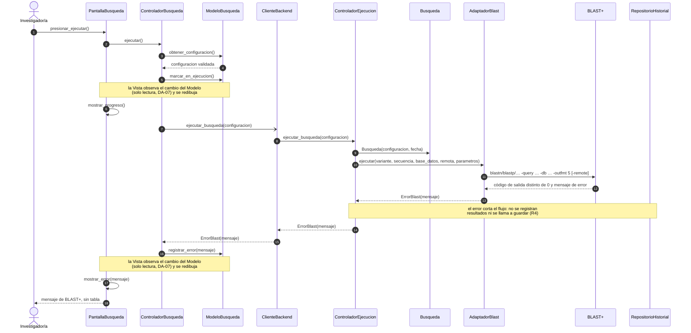

# Diseño detallado — LocalBlast

**HU08_CU004_B · Ejecutar la búsqueda validada y ver sus resultados**

Este documento baja la arquitectura de LocalBlast ([`architecture.md`](../architecture/architecture.md)) al nivel de clases para una historia de usuario. Parte de la HU y de sus criterios de aceptación, la analiza en sus tres dimensiones (funcionalidad, estructura y calidad) y deriva, en ese orden, el diagrama de robustez y los diagramas de secuencia. Cada diagrama sale del anterior: lo que no figura en la robustez no se invoca en las secuencias, y lo que no figura en las secuencias no se programa.

El modelo de clases de la sección 4 se obtuvo del código ya implementado y se validó contra la robustez y las secuencias; la sección 5 justifica el diseño, las secciones 6 y 7 describen la implementación y las pruebas, y la sección 8 traza cada criterio de la HU hasta el código y sus pruebas.

---

## Índice

1. [Introducción](#1-introducción)
2. [Relación con la arquitectura](#2-relación-con-la-arquitectura)
3. [Diseño de la HU](#3-diseño-de-la-hu)
   - 3.1 [Enunciado y criterios de aceptación](#31-enunciado-y-criterios-de-aceptación)
   - 3.2 [Entidades del modelo de dominio que intervienen](#32-entidades-del-modelo-de-dominio-que-intervienen)
   - 3.3 [Análisis tridimensional](#33-análisis-tridimensional)
   - 3.4 [Diagrama de robustez](#34-diagrama-de-robustez)
   - 3.5 [Diagramas de secuencia](#35-diagramas-de-secuencia)
   - 3.6 [Verificación de coherencia con la arquitectura](#36-verificación-de-coherencia-con-la-arquitectura)
   - 3.7 [Cambios en los documentos anteriores](#37-cambios-en-los-documentos-anteriores)
4. [Modelo de clases](#4-modelo-de-clases)
5. [Justificación del diseño](#5-justificación-del-diseño)
6. [Implementación](#6-implementación)
7. [Pruebas](#7-pruebas)
8. [Trazabilidad](#8-trazabilidad)
9. [Glosario y bibliografía](#9-glosario-y-bibliografía)

---

## 1. Introducción

### 1.1 Propósito

Definir qué clases, operaciones y colaboraciones implementan la ejecución de una búsqueda BLAST en LocalBlast, desde que el investigador presiona **Ejecutar búsqueda** hasta que ve la tabla de alineamientos y la búsqueda queda guardada en el historial. El documento es la guía para implementar y probar esa funcionalidad.

### 1.2 Historia de usuario elegida

**`HU08_CU004_B` · Ejecutar la búsqueda validada y ver sus resultados**: el camino feliz (pasos 1 a 4) del caso de uso `CU004`. Realiza RF-08, RF-09 y RF-10.

**Qué queda afuera de este diseño:**

- La **cancelación** (`HU09_CU004_A1`) y el **fallo del modo remoto** con su mensaje diferenciado (`HU10_CU004_E1`), que tienen sus propias historias.
- La **identificación del investigador** (autenticación y sesión). No tiene historia de usuario propia y no forma parte de lo que esta HU pide.
- La **validación** de la búsqueda. Es la precondición de la HU (la deja hecha `HU05_CU003_B`), así que aquí la búsqueda llega ya validada.

### 1.3 Motivo de la elección

La HU cumple las tres condiciones para sostener un diseño en tres dimensiones:

| Condición | Evidencia en la arquitectura |
|---|---|
| Está asociada a un escenario de calidad | `EC-01` (concurrencia de invocaciones) y `EC-02` (cambio menor de versión de BLAST+) llegan al componente **Adaptador BLAST+**, que la HU atraviesa (tabla 11.1 de la arquitectura) |
| Atraviesa la estructura | Su recorrido (tabla 11.2) pasa por la Aplicación Web, por las tres capas del Backend y por el sistema externo BLAST+ |
| Hay decisiones de arquitectura que la afectan | `DA-03` (Adaptador BLAST+ dedicado) y `DA-04` (un subproceso por búsqueda) citan al Adaptador; `DA-02` (capas) rige todo el recorrido por el Backend |

Más allá de esas condiciones, es **la historia que justifica la existencia del producto**. LocalBlast es una interfaz para BLAST+, y esta es la única HU en la que BLAST+ se invoca de verdad. Las historias anteriores preparan la búsqueda y las posteriores trabajan sobre resultados que ya existen. Es también la que verifica el driver de la arquitectura (interoperabilidad) y la que tiene más riesgo técnico: ejecutar sin bloquear la interfaz, atender varias búsquedas a la vez sin mezclar resultados e interpretar una salida que no controlamos.

### 1.4 Siglas

| Sigla | Significado |
|---|---|
| BD | Base de datos relacional donde se guarda el historial (no confundir con la entidad `BaseDeDatos`, que es una base de datos BLAST) |
| C4 | Modelo de documentación de arquitectura en cuatro niveles: contexto, contenedores, componentes y código |
| CA | Criterio de aceptación de una historia de usuario |
| CLI | Interfaz de línea de comandos (*command-line interface*) |
| CP | Caso de prueba |
| CU | Caso de uso |
| D2 | Almacén del DFD con las búsquedas ejecutadas y sus resultados crudos (historial) |
| DA | Decisión de arquitectura |
| DFD | Diagrama de flujo de datos |
| EC | Escenario de calidad |
| GRASP | Patrones generales para asignar responsabilidades (*General Responsibility Assignment Software Patterns*) |
| GoF | *Gang of Four*: los cuatro autores del libro clásico de patrones de diseño |
| HSP | *High-scoring Segment Pair*: cada tramo alineado que BLAST+ informa dentro de un hit |
| HTTP / HTTPS | Protocolo de la web / HTTP sobre una conexión cifrada |
| HU | Historia de usuario |
| JSON | Formato de texto para intercambiar datos estructurados; es el formato de las solicitudes entre la Aplicación Web y el Backend |
| MVC | Modelo-Vista-Controlador |
| NCBI | *National Center for Biotechnology Information*, proveedor del BLAST remoto |
| REST | Estilo de interfaz web basado en recursos y operaciones HTTP; es la interfaz que el Backend ofrece a la Aplicación Web |
| RF | Requerimiento funcional |
| SQL | Lenguaje para consultar y modificar bases de datos relacionales |
| WAL | *Write-Ahead Logging*: modo de SQLite que permite leer mientras otra conexión escribe |
| XML | Formato de datos con etiquetas; es la salida de BLAST+ que usa este diseño (`-outfmt 5`) |

---

## 2. Relación con la arquitectura

### 2.1 Tabla de coherencia

| Dimensión | Contenido |
|---|---|
| **Funcionalidad** | `HU08_CU004_B`, slice básico `CU004_B` del caso de uso `CU004 · Ejecutar la búsqueda y ver sus resultados` (pasos 1 a 4). Caminos: el principal (ejecutar, guardar en el historial y mostrar la tabla) y uno de error (BLAST+ no termina bien: no se muestra tabla ni se guarda nada, como exige la garantía mínima de `CU004`). |
| **Estructura** | Contenedor **Aplicación Web** (patrón MVC, `DA-07`): Pantallas, Controlador de búsqueda, Modelo de búsqueda, Modelo de resultados y Cliente del Backend. Contenedor **Backend** (patrón Capas, `DA-02`): **Controladores** (presentación), **Ejecución y persistencia** (dominio), **Acceso a datos** y **Adaptador BLAST+** (datos). Sistema externo **BLAST+**. Estilo base cliente-servidor (`DA-01`). **Componente principal: Ejecución y persistencia.** |
| **Calidad** | `EC-01` · hasta cinco búsquedas concurrentes sin cruce de resultados. Tácticas: *introducir concurrencia* y *encapsular*. Decisión: `DA-04` (un subproceso de BLAST+ por búsqueda). `EC-02` · cambio menor de versión de BLAST+ sin romper la lectura de la salida. Tácticas: *adaptar la interfaz* y *encapsular*. Decisión: `DA-03` (Adaptador BLAST+ dedicado en la capa de datos). |
| **Dominio** | Entidades del modelo de dominio que intervienen: `Busqueda` y `Alineamiento` como clases; `SecuenciaQuery`, `ParametrosPreBusqueda` (con su `VarianteBlast` y su `ModoEjecucion`) y `BaseDeDatos` como datos de la búsqueda. No intervienen `Investigador`, `FiltroPostBusqueda`, `Reporte` ni `FormatoDescarga` (ver [3.2](#32-entidades-del-modelo-de-dominio-que-intervienen)). |
| **Verificación** | `EC-01`: se verificará con una prueba de cinco búsquedas lanzadas a la vez sobre un adaptador simulado con demoras distintas; cada una recibe exactamente sus propios alineamientos (cero cruces). `EC-02`: se verificará con una prueba de la lectura de una salida XML con campos desconocidos; los campos obligatorios llegan intactos y queda registrada una advertencia. Las pruebas concretas se diseñan en la etapa de pruebas, una vez aprobado este diseño. |

### 2.2 Recorrido de la HU sobre los componentes

★ componente principal de la HU.

La verificación completa de coherencia con la arquitectura está en la [sección 3.6](#36-verificación-de-coherencia-con-la-arquitectura), porque necesita los diagramas de robustez y de secuencia.

---

## 3. Diseño de la HU

### 3.1 Enunciado y criterios de aceptación

> **Como** investigador/a,
> **quiero** que el sistema invoque a BLAST+ en segundo plano sobre mi búsqueda validada, con indicador de progreso y opción de cancelar, y que al terminar me muestre los alineamientos en una tabla y guarde automáticamente la búsqueda en el historial,
> **para** poder seguir trabajando en la aplicación mientras la búsqueda corre, ver los resultados apenas estén listos y no perder la búsqueda aunque no llegue a refinarla ni descargarla en esta sesión.

- **CA-01. Ejecución asíncrona con indicador de progreso.** **Given** una búsqueda ya configurada y validada (postcondición de `CU003`), **When** el investigador presiona "Ejecutar búsqueda" y el sistema invoca a BLAST+ en segundo plano, **Then** la interfaz muestra un indicador de progreso visible y permanece navegable: el investigador puede desplazarse dentro de la aplicación sin que la ejecución se interrumpa.
- **CA-02. Presentación de la tabla al finalizar.** **Given** una búsqueda en ejecución que BLAST+ termina exitosamente, **When** el sistema recibe el conjunto crudo de alineamientos, **Then** presenta los resultados en una tabla con al menos las columnas: identificador del hit, score, E-value observado, porcentaje de identidad y porcentaje de cobertura.
- **CA-03. Persistencia automática en el historial.** **Given** una búsqueda que BLAST+ terminó exitosamente, **When** el sistema recibe su conjunto crudo de alineamientos, **Then** registra en el historial (D2), antes de presentar la tabla, una entrada con los parámetros pre-búsqueda, la base de datos usada, el timestamp y el conjunto **completo** de resultados crudos que devolvió BLAST+ (antes de cualquier filtro post-búsqueda), sin que el investigador tenga que ejercer `CU005` ni `CU006` para que la persistencia ocurra.

> **Precisión de CA-03.** La redacción original registraba la búsqueda "cuando el sistema termina de mostrar" la tabla. Eso chocaba con la garantía mínima de `CU004` ("si la tabla se muestra, la entrada en D2 también queda escrita"): si se muestra primero y se guarda después, una falla entre los dos pasos deja una tabla visible sin entrada en el historial. Se invirtió el orden (primero se guarda, después se muestra) en [`historias-usuario.md`](../requeriments/historias-usuario.md) y en el flujo de `CU004` de [`casos-de-uso.md`](../requeriments/casos-de-uso.md).

**La búsqueda no se guarda antes de ejecutarse.** La secuencia y la configuración validadas las conserva la Aplicación Web (en su Modelo de búsqueda) y viajan completas en la solicitud de ejecución. La única escritura en la base es la del historial, cuando BLAST+ ya terminó (RF-10).

### 3.2 Entidades del modelo de dominio que intervienen

Se marcaron los sustantivos del enunciado y de los criterios ("búsqueda validada", "BLAST+", "alineamientos", "tabla", "historial", "parámetros pre-búsqueda", "base de datos usada", "timestamp", "resultados crudos", "identificador del hit", "score", "E-value", "porcentaje de identidad", "porcentaje de cobertura") y se buscaron en el [modelo de dominio](../requeriments/modelo-dominio.md). En verde, las entidades que intervienen. El diagrama muestra la parte del modelo que está dentro del alcance de implementación: se omiten `Usuario` y `Administrador`, porque la administración del catálogo de bases no se implementa (ver la [nota sobre el alcance](../requeriments/modelo-dominio.md#nota-sobre-el-alcance) del modelo).

| Entidad del modelo | ¿Interviene? | Qué usa la HU de ella | La HU la... |
|---|---|---|---|
| `Busqueda` | Sí, como clase | Su configuración, para invocar a BLAST+; los alineamientos que produce; el momento en que se ejecutó | Crea (a partir de la configuración validada) |
| `Alineamiento` | Sí, como clase | Identificador del hit, score, E-value, % identidad y % cobertura: las cinco columnas de la tabla | Crea |
| `SecuenciaQuery` | Sí, como dato de `Busqueda` | El texto FASTA que recibe BLAST+ y su longitud (para la cobertura) | Consulta |
| `ParametrosPreBusqueda` | Sí, como dato de `Busqueda` | E-value máximo, tamaño de palabra, matriz y penalizaciones de gap, y la variante y el modo elegidos | Consulta |
| `VarianteBlast` | Sí, como dato de `ParametrosPreBusqueda` | Qué variante de BLAST+ se invoca (`blastn`, `blastp`, …) | Consulta |
| `ModoEjecucion` | Sí, como dato de `ParametrosPreBusqueda` | Si la invocación lleva la flag `-remote` | Consulta |
| `BaseDeDatos` | Sí, como dato de `Busqueda` | Su ubicación (ruta del índice local o nombre de la base de NCBI) | Consulta |
| `Investigador` | No | La identificación del investigador queda afuera de esta HU (1.2) | — |
| `FiltroPostBusqueda` | No | CA-03 exige guardar el conjunto **crudo**; filtrar es `HU11_CU005_B` | — |
| `Reporte`, `FormatoDescarga` | No | Descargar es `HU12_CU006_B` | — |

**Por qué cinco entidades intervienen solo como datos.** `SecuenciaQuery`, `ParametrosPreBusqueda`, `VarianteBlast`, `ModoEjecucion` y `BaseDeDatos` tienen reglas propias (alfabeto, rangos, compatibilidad entre programa, query y base), pero esas reglas pertenecen a las HU de carga, configuración y validación (`HU01` a `HU07`). Esta HU solo lee sus valores para pasárselos a BLAST+ y guardarlos en el historial. Alcanza con que `Busqueda` los exponga como atributos (la configuración que recibe); convertirlas en clases acá agregaría clases sin comportamiento.

**Cambios al modelo de dominio.** Al armar esta tabla se detectó que el modelo no tenía el concepto de variante de BLAST (hoy `VarianteBlast`) y que tenía multiplicidades que contradecían a `CU001` (una misma secuencia se usa en varias búsquedas). En una segunda revisión se reorganizaron las relaciones para que no pasen todas por `Busqueda`: la variante y el modo cuelgan ahora de `ParametrosPreBusqueda` (se eligen en la misma configuración previa), y `FiltroPostBusqueda` se conecta con `Alineamiento` y con `Reporte`, que es lo que realmente toca, en lugar de con `Busqueda`. Los cambios están en el *Registro de cambios* de [`modelo-dominio.md`](../requeriments/modelo-dominio.md#registro-de-cambios) (cambios 1 a 11). También se renombró `ProgramaBlast` a `VarianteBlast`, porque el nombre anterior se confundía con BLAST+.

### 3.3 Análisis tridimensional

| Elemento | Funcionalidad (qué hace) | Estructura (con qué se hace) | Calidad (qué propiedad cumple) |
|---|---|---|---|
| **CA-01** | Lanzar la búsqueda sin bloquear la interfaz y mostrar un indicador de progreso hasta que llegue la respuesta | `PantallaBusqueda` (delega y muestra el estado de los Modelos); `ControladorBusqueda` (marca la búsqueda en ejecución en `ModeloBusqueda` y pide la ejecución a `ClienteBackend` de forma asíncrona); `ControladorEjecucion` | La interfaz sigue navegable mientras BLAST+ corre, porque nadie en el cliente se queda bloqueado esperando la respuesta |
| **CA-02** | Al terminar BLAST+, mostrar la tabla con hit, score, E-value, % identidad y % cobertura | `AdaptadorBlast` (invoca y lee la salida); `Busqueda` y `Alineamiento`, que calcula sus porcentajes; en el cliente, `ControladorBusqueda` carga las filas en `ModeloResultados` y `PantallaBusqueda` las dibuja al observar el cambio | `EC-02`: si la salida trae campos nuevos, la tabla igual sale con los campos obligatorios intactos |
| **CA-03** | Guardar en el historial la búsqueda con parámetros, base, timestamp y todos los alineamientos crudos | `RepositorioHistorial` (arma el registro a partir de `Busqueda`) y `ConexionBD` (lo escribe en la base en una transacción) | Nunca se muestra una tabla sin su entrada en el historial: primero se guarda y después se devuelve la tabla |
| **`EC-01`** · Concurrencia | Hasta cinco investigadores ejecutan a la vez | Cada solicitud se atiende en su propio hilo del servidor; `AdaptadorBlast` lanza un subproceso propio por búsqueda | **Cero cruces de resultados**: los resultados vuelven por la misma llamada que los pidió, sin estado compartido entre búsquedas |
| **`EC-02`** · Cambio de versión de BLAST+ | BLAST+ devuelve campos que el sistema no conoce | `AdaptadorBlast`, que es el único que conoce el formato de la salida | El 100 % de las salidas "casi conocidas" conserva los campos obligatorios y deja una advertencia en el log |

Los escenarios de **tolerancia a fallos** (rate limit y timeout de NCBI) describen el error del modo remoto, que es `HU10_CU004_E1`. Los de **confidencialidad** dependen de la identificación del investigador, que queda afuera de esta HU. Los de **operabilidad** alcanzan a la configuración (`HU05`) y al filtrado (`HU11`).

### 3.4 Diagrama de robustez

Leyenda: borde punteado = actor o sistema externo; cilindro gris = almacén de datos; rectángulo redondeado azul = *boundary*; círculo naranja = *controller*; rectángulo con barras verde = *entity*. Los recuadros grises agrupan los elementos de cada contenedor y el recuadro verde punteado, el agregado `Busqueda`. Cada flecha dice qué le pide un elemento a otro.

**Cómo se clasificó cada elemento.**

- **Fronteras.** Hay tres, una por cada cosa con la que el sistema habla y que no es código nuestro: el investigador, a través de `PantallaBusqueda`; BLAST+, a través de `AdaptadorBlast`; y el motor de base de datos, a través de `ConexionBD`. La base de datos es un contenedor de LocalBlast, pero no tiene lógica nuestra: es un producto de terceros (PostgreSQL) al que se llega por una conexión y un protocolo (SQL). Para el código del Backend es tan externa como BLAST+, y por eso se accede a ella por una frontera y no directamente desde un controlador.
- **Controladores de la Aplicación Web.** `ControladorBusqueda` interpreta la acción del investigador y actualiza los Modelos (rol Controlador del MVC). `ClienteBackend` es el único que sabe hablar con el Backend por HTTP. La comunicación entre la Aplicación Web y el Backend **no** es una frontera: los dos contenedores tienen lógica nuestra y en los dos extremos hay controladores, así que es una coordinación entre controladores.
- **Controladores del Backend.** `ControladorEjecucion` coordina la ejecución. `RepositorioHistorial` sabe **qué** se guarda del historial (arma el registro a partir de la `Busqueda`), y `ConexionBD` sabe **cómo** se habla con el motor (conexión, sentencias SQL y transacción). El repositorio es un controlador técnico: no tiene reglas del negocio, solo coordina el guardado.
- **Entidades del Backend.** `Busqueda` y `Alineamiento`, que salen de la tabla 3.2. Forman un agregado: un alineamiento no existe sin su búsqueda, y desde afuera se accede siempre a través de `Busqueda`. Por eso `Alineamiento` no tiene flechas propias: solo lo crea y lo consulta su `Busqueda`.
- **Entidades de la Aplicación Web.** `ModeloBusqueda` y `ModeloResultados` son el rol Modelo del MVC: la representación, en el cliente, de la `Busqueda` que se va a ejecutar (su configuración validada y su estado) y de sus `Alineamiento` ya calculados (las filas de la tabla). No son entidades nuevas del dominio, sino la copia en el cliente de dos que ya están en el modelo.
- **Base de datos.** Es el almacén donde queda el historial (D2), en el contenedor *Base de datos*. No es una de las tres categorías de la robustez: se dibuja para mostrar dónde terminan los datos, igual que BLAST+. Solo la toca `ConexionBD`.

**Reglas de conexión verificadas.**

| Tipo de conexión | Flechas del diagrama | ¿Permitida? |
|---|---|---|
| Actor → boundary | Investigador → `PantallaBusqueda` | Sí |
| Boundary → controller | `PantallaBusqueda` → `ControladorBusqueda` | Sí |
| Controller → boundary | `ControladorEjecucion` → `AdaptadorBlast`; `RepositorioHistorial` → `ConexionBD` | Sí: el controlador se apoya en fronteras para llegar a un sistema externo |
| Controller → controller | `ControladorBusqueda` → `ClienteBackend` → `ControladorEjecucion` → `RepositorioHistorial` | Sí |
| Controller → entity | `ControladorBusqueda` → `ModeloBusqueda`, `ModeloResultados`; `ControladorEjecucion` → `Busqueda`; `RepositorioHistorial` → `Busqueda` | Sí |
| Boundary → sistema externo o almacén | `AdaptadorBlast` → BLAST+; `ConexionBD` → Base de datos | Sí: es la razón de ser de esas fronteras |
| Boundary → entity | — | No hay ninguna |
| Actor → controller o entity | — | No hay ninguna |

- **La pantalla no se conecta con ninguna entidad en el diagrama.** En la arquitectura, la Vista observa a los Modelos para leer su estado y redibujarse cuando cambia (`DA-07`, relación *Muestra* del catálogo de la Aplicación Web), pero nunca los modifica ni decide con ellos. Esa observación de solo lectura **no se dibuja en la robustez**, porque el diagrama no admite conexiones de una frontera a una entidad. Lo que el diagrama sí muestra es la regla de fondo: toda acción de la pantalla pasa por `ControladorBusqueda`, que es el único que modifica los Modelos. En los diagramas de secuencia la observación aparece como una nota, no como un mensaje.
- **La Vista nunca se conecta con el Backend:** el único camino hacia el servidor es `ControladorBusqueda → ClienteBackend → ControladorEjecucion`.
- `AdaptadorBlast` recibe datos simples y devuelve los hits como datos, no como `Alineamiento`.
- BLAST+ se alcanza solo a través de su frontera, y la base de datos solo a través de `RepositorioHistorial` y `ConexionBD`.

#### 3.4.1 Dónde vive cada regla del negocio

| # | Regla | Dónde vive | Por qué |
|---|---|---|---|
| R1 | % identidad = identidades ÷ longitud del alineamiento × 100; % cobertura = tramo de la query cubierto ÷ longitud de la query × 100 | Entidad `Alineamiento` | Experto: el alineamiento tiene todos los datos para calcularlos. La longitud de la query se la pasa `Busqueda` al crearlo |
| R2 | Al historial va el conjunto **completo** de alineamientos crudos, sin filtrar | Entidad `Busqueda` | Crea un `Alineamiento` por cada hit que devolvió BLAST+ y no descarta ninguno. Es el conjunto que después guarda el repositorio |
| R3 | La tabla se devuelve solo después de que la búsqueda quedó en el historial | `ControladorEjecucion` (orden de los pasos) | Es una regla de coordinación entre dos colaboradores (el repositorio y quien pidió la ejecución), y por eso el orden lo fija el controlador |
| R4 | Si BLAST+ no termina bien, no se muestra tabla ni se guarda nada (garantía mínima de `CU004`) | `AdaptadorBlast` (avisa con `ErrorBlast`) y `ControladorEjecucion` (el error corta el flujo antes de registrar y de guardar) | El Adaptador es quien sabe que BLAST+ falló (código de salida); el controlador no necesita ningún `if`, porque el error interrumpe la secuencia |
| R5 | Los campos de la salida de BLAST+ que no se conocen se ignoran y se advierten, sin tocar los conocidos (`EC-02`) | `AdaptadorBlast` | Táctica *adaptar la interfaz*: el formato de BLAST+ se conoce en un solo lugar (`DA-03`) |
| R6 | La ejecución pasa por los estados *en ejecución*, *finalizada* o *con error*, y la pantalla muestra progreso, tabla o mensaje según el estado | `ModeloBusqueda` (guarda el estado) y `ControladorBusqueda` (lo cambia) | Es estado de la interacción en el cliente, no del dominio. La Vista solo lo lee, al observar el Modelo, para saber qué dibujar |
| R7 | El registro del historial se escribe completo o no se escribe (la búsqueda y todos sus alineamientos en una sola transacción) | `ConexionBD` | Si la escritura falla a la mitad, no puede quedar una búsqueda con parte de sus alineamientos. La transacción es un detalle del motor de base de datos, y solo la frontera hacia la base lo conoce |

Las reglas del dominio (R1 a R5) viven en el Backend. La pantalla no aplica ninguna: solo muestra lo que tienen los Modelos.

#### 3.4.2 Elementos del diagrama y componentes de la arquitectura

| Elemento | Tipo | Contenedor | Componente | Capa / rol |
|---|---|---|---|---|
| `PantallaBusqueda` | boundary | Aplicación Web | Pantallas | Vista (MVC) |
| `ControladorBusqueda` | controller | Aplicación Web | Controlador de búsqueda | Controlador (MVC) |
| `ModeloBusqueda` | entity | Aplicación Web | Modelo de búsqueda | Modelo (MVC) |
| `ModeloResultados` | entity | Aplicación Web | Modelo de resultados | Modelo (MVC) |
| `ClienteBackend` | controller | Aplicación Web | Cliente del Backend | Apoyo (fuera de la tríada MVC) |
| `ControladorEjecucion` | controller | Backend | **Ejecución y persistencia** | Dominio |
| `Busqueda`, `Alineamiento` | entity | Backend | Ejecución y persistencia | Dominio |
| `RepositorioHistorial` | controller | Backend | Acceso a datos | Datos |
| `ConexionBD` | boundary | Backend | Acceso a datos | Datos |
| `AdaptadorBlast` | boundary | Backend | Adaptador BLAST+ | Datos |
| BLAST+ | sistema externo | — | — | — |
| Base de datos (historial D2) | almacén de datos | Base de datos (PostgreSQL) | — | — |

**Nota sobre el componente Controladores del Backend.** El mensaje de `ClienteBackend` a `ControladorEjecucion` llega por HTTP a una ruta del Backend (componente **Controladores**) que solo convierte la solicitud JSON en la llamada a `ejecutar_busqueda` y el resultado en la respuesta JSON. Es código del framework web sin lógica propia, y por eso no se modela como clase. Así el recorrido respeta la cadena del patrón Capas: Controladores → Ejecución y persistencia → Acceso a datos / Adaptador BLAST+.

**Nota sobre la persistencia intercambiable.** Que el historial se pueda guardar en memoria o en una base real sin tocar `ControladorEjecucion` es una decisión de clases (el controlador conocerá al repositorio solo por su interfaz). Se mostrará en el modelo de clases que se obtenga del código; la robustez no la representa con estereotipos.

### 3.5 Diagramas de secuencia

Hay dos diagramas: el camino principal y el camino de error. Ambos usan solo los participantes del diagrama de robustez. **Cada flecha sólida es una llamada a una operación de la clase que la recibe**: el texto de la flecha es el nombre de esa operación, que al implementar pasa al código con ese mismo nombre. Las flechas punteadas son respuestas. Las únicas excepciones son las flechas hacia BLAST+ y hacia la base de datos, que no son clases nuestras: su texto es la línea de comandos o la sentencia con que se las usa.

**Cómo se redibuja la Vista.** Cuando `ControladorBusqueda` cambia un Modelo, la Vista se entera por suscripción (en React, el cambio de estado provoca que el componente se vuelva a dibujar) y lee el estado del Modelo, como fija `DA-07`. Como en la robustez no hay conexión de la pantalla con los Modelos, en las secuencias esa lectura se muestra como una nota seguida de lo que dibuja la pantalla (`mostrar_progreso`, `mostrar_resultados` o `mostrar_error`), y no como un mensaje. El Modelo nunca llama a la Vista: no la conoce.

#### Secuencia 1 · Camino principal

Las tácticas de calidad se ven como operaciones concretas:

- **Introducir concurrencia (`EC-01`).** Cada solicitud de ejecución se atiende en su propio hilo del servidor, y en ese hilo `ejecutar` lanza un **subproceso propio** de BLAST+ y espera su salida (`DA-04`). Los hits vuelven por la misma llamada al mismo `ejecutar_busqueda` que los pidió. No hay ningún lugar compartido donde los resultados de dos búsquedas puedan mezclarse.
- **Adaptar la interfaz y encapsular (`EC-02`).** El controlador y las entidades nunca ven el XML de BLAST+. `leer_salida` toma los campos que conoce por su nombre y, si hay otros, el fragmento `opt` muestra cómo se advierten sin romper nada (`DA-03`).

#### Secuencia 2 · Camino de error: BLAST+ no termina bien

Este camino cubre la garantía mínima de `CU004`: si la ejecución no termina bien, no se muestra ninguna tabla y no se escribe nada en el historial. `RepositorioHistorial` figura en el diagrama justamente para mostrar que no recibe ninguna llamada; `ModeloResultados`, `ConexionBD` y la base de datos no aparecen porque no se usan. El tratamiento específico del error remoto (distinguir un timeout de un rechazo de NCBI) es de `HU10_CU004_E1`.

#### 3.5.1 Asignación de responsabilidades

| Responsabilidad | Quién | Criterio GRASP |
|---|---|---|
| Recibir el clic y mostrar el progreso, la tabla o el error según lo que tengan los Modelos | `PantallaBusqueda` | Bajo acoplamiento: para actuar solo conoce a `ControladorBusqueda`; a los Modelos solo los observa para leer, y no decide nada |
| Interpretar la acción "ejecutar" en el cliente: tomar la configuración, cambiar el estado, pedir la ejecución, cargar el resultado o el error | `ControladorBusqueda` | Controlador (del lado cliente) |
| Conservar la configuración validada y el estado de la ejecución | `ModeloBusqueda` | Experto en información |
| Conservar las filas recibidas para la tabla (y luego filtrarlas, en `HU11`) | `ModeloResultados` | Experto en información |
| Hablar con el Backend por HTTP | `ClienteBackend` | Bajo acoplamiento y alta cohesión: es lo único del cliente que conoce la forma de la interfaz REST |
| Coordinar la ejecución en el servidor: crear la búsqueda, invocar a BLAST+, registrar, guardar y devolver la tabla | `ControladorEjecucion` | Controlador: orquesta sin hacer el trabajo del dominio |
| Crear la `Busqueda` | `ControladorEjecucion` | Creador: es quien recibe la configuración con la que se inicializa |
| Crear los `Alineamiento` a partir de los hits | `Busqueda` | Creador: la búsqueda contiene a sus alineamientos y tiene el dato que les falta (la longitud de la query) |
| Calcular % identidad y % cobertura | `Alineamiento` | Experto en información |
| Armar las filas de la tabla | `Busqueda` | Experto: conoce todos sus alineamientos |
| Invocar a BLAST+ y leer su salida, advirtiendo los campos desconocidos | `AdaptadorBlast` | Bajo acoplamiento (es lo único que conoce a BLAST+) y alta cohesión |
| Armar el registro del historial a partir de la búsqueda y pedir que se escriba | `RepositorioHistorial` | Alta cohesión y bajo acoplamiento: el controlador pide "guardar" sin saber cómo ni dónde se guarda |
| Escribir el registro en la base de datos en una sola transacción | `ConexionBD` | Bajo acoplamiento y alta cohesión: es lo único que conoce el motor de base de datos y SQL |

### 3.6 Verificación de coherencia con la arquitectura

**Cada mensaje entre componentes distintos existe en el catálogo de relaciones.** Los mensajes entre elementos del mismo componente (por ejemplo, `ControladorEjecucion → Busqueda` o `RepositorioHistorial → ConexionBD`) no necesitan una relación en el catálogo.

| Mensaje de la secuencia | Componente origen → destino | Relación del catálogo |
|---|---|---|
| `PantallaBusqueda → ControladorBusqueda`: `ejecutar()` | Pantallas → Controlador de búsqueda | *Delega* ([7.2.2](../architecture/architecture.md#722-catálogo-de-relaciones-de-la-aplicación-web)) |
| Observación de `PantallaBusqueda` sobre `ModeloBusqueda` y `ModeloResultados` (notas de las secuencias) | Pantallas → Modelo de búsqueda y Modelo de resultados | *Muestra*, solo lectura (7.2.2). No se dibuja en la robustez porque el diagrama no admite frontera → entidad |
| `ControladorBusqueda → ModeloBusqueda`: `obtener_configuracion()`, `marcar_en_ejecucion()`, `marcar_finalizada()`, `registrar_error()` | Controlador de búsqueda → Modelo de búsqueda | *Actualiza* (7.2.2) |
| `ControladorBusqueda → ModeloResultados`: `cargar()` | Controlador de búsqueda → Modelo de resultados | *Carga resultados* (7.2.2) |
| `ControladorBusqueda → ClienteBackend`: `ejecutar_busqueda()` | Controlador de búsqueda → Cliente del Backend | *Envía* (7.2.2) |
| `ClienteBackend → ControladorEjecucion`: `ejecutar_busqueda()` | Cliente del Backend → Controladores → Ejecución y persistencia | *Solicita* (7.2.2 y 7.1.2) e *Invoca* ([7.1.2](../architecture/architecture.md#712-catálogo-de-relaciones-del-backend)) |
| `ControladorEjecucion → AdaptadorBlast`: `ejecutar()` | Ejecución y persistencia → Adaptador BLAST+ | *Ejecuta* (7.1.2) |
| `AdaptadorBlast → BLAST+` | Adaptador BLAST+ → BLAST+ | *Invoca*, CLI / subproceso (7.1.2) |
| `ControladorEjecucion → RepositorioHistorial`: `guardar()` | Ejecución y persistencia → Acceso a datos | *Persiste* (7.1.2) |
| `ConexionBD → Base de datos` | Acceso a datos → Base de datos | *Lee y escribe*, SQL (7.1.2) |

**Patrones y estilo del TP de arquitectura.**

- **Capas en el Backend (`DA-02`).** El recorrido baja siempre: Controladores → Ejecución y persistencia → Acceso a datos y Adaptador BLAST+. Ningún elemento de la capa de datos llama a uno de dominio; `RepositorioHistorial` recibe la `Busqueda` como parámetro y la traduce a un registro, que es la responsabilidad que el catálogo le da a Acceso a datos. No se saltea ninguna capa.
- **MVC en la Aplicación Web (`DA-07`).** La Vista delega toda acción en el Controlador y a los Modelos solo los observa para leer; solo el Controlador modifica los Modelos; los Modelos no conocen a nadie; el Cliente del Backend solo lo usa el Controlador.
- **Cliente-servidor (`DA-01`).** El único canal entre la Aplicación Web y el Backend es la solicitud JSON / HTTPS de `ClienteBackend`.
- **Tácticas de calidad.** `EC-01` se ve en el subproceso propio que lanza `ejecutar` (`DA-04`); `EC-02`, en `leer_salida` y `registrar_advertencia` del Adaptador (`DA-03`).

### 3.7 Cambios en los documentos anteriores

Al bajar al diseño aparecieron diferencias con documentos anteriores. Se documentan y se actualizaron esos documentos:

| Documento | Cambio | Motivo |
|---|---|---|
| [`modelo-dominio.md`](../requeriments/modelo-dominio.md#registro-de-cambios) | `VarianteBlast` y `ModoEjecucion` cuelgan de `ParametrosPreBusqueda`; `FiltroPostBusqueda` se conecta con `Alineamiento` y `Reporte` en vez de con `Busqueda` (cambios 8 y 9). `ProgramaBlast` se renombra `VarianteBlast` (cambio 11) | Casi todas las relaciones pasaban por `Busqueda`, aunque varias entidades se relacionan entre sí sin pasar por ella. El nombre `ProgramaBlast` se confundía con BLAST+ |
| [`historias-usuario.md`](../requeriments/historias-usuario.md) y [`casos-de-uso.md`](../requeriments/casos-de-uso.md) | Orden de CA-03 de `HU08` y del flujo de `CU004`: primero se guarda en el historial y después se muestra la tabla | Ver la precisión de CA-03 en [3.1](#31-enunciado-y-criterios-de-aceptación) |

---

## 4. Modelo de clases

### 4.1 Cómo se obtuvo

El diagrama se obtuvo del código implementado, no se dibujó antes de programar.

- **Backend:** ingeniería inversa con `pyreverse` (de pylint) sobre `src/backend`. La salida sin editar está en [`clases-backend-pyreverse.md`](clases-backend-pyreverse.md), junto con el comando para regenerarla.
- **Aplicación Web:** `pyreverse` solo lee Python, así que las clases de JavaScript se tomaron del código (`src/web/src`) y se revisaron contra él clase por clase.
- **Limpieza:** se dejaron las clases de la HU y se quitaron las de librerías (pydantic, FastAPI). Los métodos privados se muestran con `-` y los públicos con `+`.

### 4.2 Diagrama

Reúne lo que aparece en las dos secuencias (camino principal y camino de error).

```mermaid
classDiagram
    direction LR

    namespace AplicacionWeb {
        class PantallaBusqueda {
            <<boundary · componente React>>
            +mostrar_busqueda_validada(configuracion, ejecutar)
            +mostrar_progreso(configuracion, inicio, transcurrido)
            +mostrar_resultados(filas, configuracion, modeloBusqueda)
            +mostrar_error(mensaje, configuracion, reintentar)
        }
        class ControladorBusqueda {
            -modeloBusqueda: ModeloBusqueda
            -modeloResultados: ModeloResultados
            -cliente: ClienteBackend
            +ejecutar() Promise
        }
        class ModeloObservable {
            -suscriptores: Set
            +suscribir(alCambiar) Function
            +notificar()
        }
        class ModeloBusqueda {
            -configuracion: Object
            -estado: Estado
            -mensajeError: string
            -inicio: Date
            -fin: Date
            +obtener_configuracion() Object
            +obtener_estado() Estado
            +obtener_mensaje_error() string
            +obtener_inicio() Date
            +obtener_fin() Date
            +marcar_en_ejecucion()
            +marcar_finalizada()
            +registrar_error(mensaje)
        }
        class ModeloResultados {
            -filas: Object[]
            -cargados: boolean
            +cargar(filas)
            +obtener_filas() Object[]
            +estan_cargados() boolean
        }
        class ClienteBackend {
            -urlBase: string
            +ejecutar_busqueda(configuracion) Promise~filas~
        }
    }

    namespace Backend {
        class ControladorEjecucion {
            -adaptador: AdaptadorBlast
            -repositorio: RepositorioHistorial
            -reloj: Callable
            +ejecutar_busqueda(configuracion: dict) list~dict~
        }
        class Busqueda {
            +secuencia: str
            +variante: str
            +modo: str
            +base_datos: str
            +parametros: dict
            +fecha: datetime
            +es_remota: bool
            +longitud_query: int
            +alineamientos: tuple
            +registrar_resultados(hits: list~Hit~)
            +armar_tabla_resultados() list~dict~
        }
        class Alineamiento {
            +id_hit: str
            +descripcion: str
            +score: float
            +evalue: float
            +identidades: int
            +longitud_alineamiento: int
            +query_desde: int
            +query_hasta: int
            +longitud_query: int
            +calcular_porcentaje_identidad() float
            +calcular_porcentaje_cobertura() float
        }
        class AdaptadorBlast {
            <<interface>>
            +ejecutar(variante, secuencia, base_datos, remota, parametros) list~Hit~
        }
        class AdaptadorBlastCli {
            -ejecutor: EjecutorComando
            -directorio_blast: Path
            -directorio_trabajo: Path
            -limite_segundos: float
            +ejecutar(variante, secuencia, base_datos, remota, parametros) list~Hit~
            +leer_salida(salida_xml: str) list~Hit~
            +registrar_advertencia(campos: list~str~)
            -armar_comando(variante, base_datos, remota, parametros) list~str~
            -leer_hit(hit: Element) Hit
        }
        class EjecutorComando {
            <<tipo función>>
            +\_\_call\_\_(comando, entrada, directorio, limite) ResultadoComando
        }
        class BlastSimulado {
            -demora_segundos: float
            -campo_nuevo: bool
            +\_\_call\_\_(comando, entrada, directorio, limite) ResultadoComando
        }
        class ResultadoComando {
            <<dataclass>>
            +codigo: int
            +salida: str
            +errores: str
        }
        class Hit {
            <<TypedDict>>
        }
        class ErrorBlast {
            <<exception>>
        }
        class RepositorioHistorial {
            <<interface>>
            +guardar(busqueda: Busqueda)
        }
        class RepositorioHistorialSqlite {
            -conexion: ConexionBD
            +guardar(busqueda: Busqueda)
        }
        class RepositorioHistorialEnMemoria {
            +busquedas_guardadas: tuple
            +guardar(busqueda: Busqueda)
        }
        class ConexionBD {
            <<boundary>>
            -ruta: Path
            +ejecutar_transaccion(registro: list~Sentencia~)
            -abrir_conexion() Connection
        }
    }

    PantallaBusqueda --> ControladorBusqueda : delega ejecutar()
    PantallaBusqueda ..> ModeloBusqueda : observa (lectura)
    PantallaBusqueda ..> ModeloResultados : observa (lectura)
    ControladorBusqueda --> ModeloBusqueda
    ControladorBusqueda --> ModeloResultados
    ControladorBusqueda --> ClienteBackend
    ModeloObservable <|-- ModeloBusqueda
    ModeloObservable <|-- ModeloResultados
    ClienteBackend ..> ControladorEjecucion : POST /api/busquedas/ejecucion (JSON/HTTPS)

    ControladorEjecucion --> AdaptadorBlast
    ControladorEjecucion --> RepositorioHistorial
    ControladorEjecucion ..> Busqueda : crea
    Busqueda "1" *-- "*" Alineamiento : produce
    AdaptadorBlastCli ..|> AdaptadorBlast
    AdaptadorBlastCli --> EjecutorComando
    BlastSimulado ..|> EjecutorComando
    EjecutorComando ..> ResultadoComando
    AdaptadorBlastCli ..> Hit : crea
    AdaptadorBlastCli ..> ErrorBlast : lanza
    RepositorioHistorialSqlite ..|> RepositorioHistorial
    RepositorioHistorialEnMemoria ..|> RepositorioHistorial
    RepositorioHistorialSqlite --> ConexionBD
    RepositorioHistorial ..> Busqueda : guarda
```

**Cómo leerlo.**

- **Interfaces:** `AdaptadorBlast` y `RepositorioHistorial` son los participantes de las secuencias. Las clases que las realizan (`..|>`) son las que elige el punto de arranque (`arranque.py`).
- **`EjecutorComando`:** es el tipo de la función que ejecuta BLAST+. La aplicación usa `ejecutar_subproceso`, una función que lanza el programa real, o `BlastSimulado`.
- **Asociaciones de los controladores:** sus colaboradores llegan por el constructor.
- **Tipos auxiliares:** `Hit`, `ResultadoComando` y `ErrorBlast` son los datos que viajan en los mensajes (los hits, la salida de BLAST+ y el error).
- **Composición:** la de `Busqueda` con `Alineamiento` es la del agregado y la del modelo de dominio.
- **Comunicación entre contenedores:** la flecha de `ClienteBackend` a `ControladorEjecucion` es la solicitud HTTP. Entre las dos está la ruta del componente Controladores (`rutas.py`), que es código del framework y no se modela como clase (ver 3.4.2).

### 4.3 Validación contra la robustez y las secuencias

Se recorrió el diagrama obtenido contra el diagrama de robustez (3.4) y las dos secuencias (3.5). Estas son las diferencias encontradas y qué se hizo con cada una:

| # | Diferencia encontrada | Qué estaba mal | Resolución |
|---|---|---|---|
| V1 | `pyreverse` no mostraba las asociaciones de `ControladorEjecucion` con el adaptador y el repositorio, ni la de `RepositorioHistorialSqlite` con `ConexionBD` | El código: esos atributos no declaraban su tipo | Se corrigió el código (tipos en los atributos) y se regeneró el diagrama. Ahora la herramienta ve las cuatro asociaciones |
| V2 | Operaciones con nombre de sustantivo: `porcentaje_identidad`, `porcentaje_cobertura`, `tabla_resultados`, `configuracion`, y los métodos de lectura de los Modelos | El diseño y el código: una operación es una acción y su nombre tiene que ser un verbo | Se renombraron en el código y en las secuencias: `calcular_porcentaje_identidad`, `calcular_porcentaje_cobertura`, `armar_tabla_resultados`, `obtener_configuracion`, `obtener_estado`, `obtener_filas`, etc. La clase `Observable` (un adjetivo) pasó a llamarse `ModeloObservable` |
| V3 | El diagrama tiene `AdaptadorBlastCli`, `RepositorioHistorialSqlite` y `RepositorioHistorialEnMemoria`, que no figuran en la robustez ni en las secuencias | Nada: las secuencias usan las interfaces | Se mantiene. Cada interfaz tiene implementaciones con un uso concreto (decisión I1 y sección 5). En la robustez no se usan estereotipos de interfaz |
| V4 | El participante "BLAST+" de las secuencias aparece como `EjecutorComando`, con dos implementaciones (`ejecutar_subproceso` y `BlastSimulado`) | Nada | Se mantiene: es el sistema externo, reemplazable por uno simulado detrás de un tipo común (6.2) |
| V5 | `ModeloObservable` no aparece en la robustez ni en las secuencias | Nada: es el mecanismo de la observación de la Vista sobre los Modelos (`DA-07`), que las secuencias muestran como nota | Se mantiene y se nombra el patrón (5.3) |
| V6 | Los métodos de lectura de los Modelos (`obtener_estado`, `obtener_fin`, `obtener_filas`, `estan_cargados`) no son mensajes de las secuencias | Nada: son las lecturas que hace la Vista al observar, que las secuencias muestran como nota | Se mantienen |
| V7 | `PantallaBusqueda` dibuja además la búsqueda validada antes de ejecutar (`mostrar_busqueda_validada`) | Nada: es el estado previo al primer mensaje de las secuencias | Se mantiene (decisión I9) |
| V8 | `ConexionBD` crea el esquema de la base al construirse, y `Busqueda` y `ModeloBusqueda` rechazan operaciones fuera de orden (I5, I6) | Nada: son reglas de integridad de cada clase, no mensajes entre participantes | Se mantienen; están probadas (CP-34, CP-47) |
| V9 | La ruta HTTP y su `SolicitudEjecucion` no figuran como clases del diseño | Nada | Se mantiene: es código del framework sin lógica propia (nota de 3.4.2); solo valida la forma de la solicitud (CP-17) |
| V10 | La base de datos es SQLite; el contenedor *Base de datos* del documento de arquitectura es PostgreSQL | Ninguno de los dos: la persistencia es de libre elección para esta entrega | Se documenta. Pasar a PostgreSQL solo cambia `ConexionBD` (el motor) y el esquema; ni el repositorio ni el controlador cambian |

**Lo que se comprobó.**

- **Clases:** cada participante de las secuencias es una clase (o una interfaz) del diagrama, y cada mensaje es una operación con el mismo nombre.
- **Reglas:** cada regla vive donde dice la robustez (3.4.1). `Alineamiento` calcula sus porcentajes (R1), `Busqueda` crea el conjunto completo de alineamientos (R2), `ControladorEjecucion` guarda antes de devolver la tabla (R3), `AdaptadorBlastCli` detecta el error y los campos desconocidos (R4 y R5), `ModeloBusqueda` guarda el estado (R6) y `ConexionBD` escribe todo o nada (R7).
- **Clases que no son participantes directos:** las que no figuran en ninguna secuencia son implementaciones de un participante (V3 y V4), el mecanismo de observación (V5) o datos que viajan en un mensaje (`Hit`, `ResultadoComando`, `ErrorBlast`).
- **Entidades no anémicas:** `Alineamiento` y `Busqueda` tienen comportamiento propio (cálculo de porcentajes, creación de alineamientos, armado de la tabla, control de integridad). `ControladorEjecucion` no tiene ningún `if` (complejidad 1, sección 7.3).

---

## 5. Justificación del diseño

### 5.1 Responsabilidades y criterios GRASP

| Clase | Responsabilidad | Criterio GRASP |
|---|---|---|
| `PantallaBusqueda` | Recibir la acción del investigador y mostrar lo que tienen los Modelos | Bajo acoplamiento: para actuar solo conoce a `ControladorBusqueda`; a los Modelos solo los lee |
| `ControladorBusqueda` | Interpretar "ejecutar" en el cliente: tomar la configuración, cambiar el estado, pedir la ejecución y cargar el resultado o el error | Controlador |
| `ModeloBusqueda` | Guardar la configuración validada y el estado de la ejecución, y no aceptar transiciones inválidas | Experto en información |
| `ModeloResultados` | Guardar las filas recibidas (y filtrarlas en `HU11`) | Experto en información |
| `ClienteBackend` | Hablar con el Backend por HTTP y traducir su error a `ErrorBlast` | Alta cohesión y bajo acoplamiento: es lo único del cliente que conoce la interfaz REST |
| `ControladorEjecucion` | Coordinar la ejecución en el servidor y crear la `Busqueda` | Controlador; Creador (tiene la configuración con la que se inicializa la búsqueda) |
| `Busqueda` | Crear sus alineamientos, armar la tabla y conocer los datos de la query | Creador (contiene a sus alineamientos); Experto en información |
| `Alineamiento` | Calcular su % de identidad y su % de cobertura | Experto en información |
| `AdaptadorBlastCli` | Invocar a BLAST+ y traducir su salida a hits | Bajo acoplamiento y alta cohesión: es lo único que conoce el formato de BLAST+ |
| `RepositorioHistorialSqlite` | Decidir qué se guarda de una búsqueda (el registro) | Alta cohesión: no sabe cómo se habla con el motor |
| `ConexionBD` | Hablar con el motor de base de datos y garantizar la transacción | Alta cohesión y bajo acoplamiento: es lo único que conoce SQLite |

### 5.2 Decisiones de diseño

| # | Decisión | Por qué | Costo asumido |
|---|---|---|---|
| D1 | Interfaces `AdaptadorBlast` y `RepositorioHistorial` | Cada una tiene dos implementaciones con un uso concreto. El adaptador real con BLAST+ real o simulado, y el doble en las pruebas. El repositorio SQLite en la aplicación y el de memoria en las pruebas. El controlador no cambia con ninguna (se muestra en la defensa cambiando una variable de entorno) | Un nivel más de indirección. No se agregaron interfaces donde hay una sola implementación posible (por ejemplo, `ConexionBD` o `Busqueda`) |
| D2 | Las reglas de los porcentajes y del conjunto crudo viven en las entidades, no en el controlador | `Alineamiento` y `Busqueda` tienen los datos (Experto). Ningún camino puede saltear la regla, y el controlador queda sin decisiones | Ninguno relevante |
| D3 | El orden "guardar antes de devolver la tabla" vive en el controlador | Es una regla de coordinación entre dos colaboradores, no de una entidad | — |
| D4 | `RepositorioHistorialSqlite` (qué se guarda) separado de `ConexionBD` (cómo se escribe) | Responde a la observación de la robustez: hace falta una frontera hacia la base de datos. Además, cambiar de motor toca solo `ConexionBD` | Una clase más en el acceso a datos |
| D5 | El BLAST+ simulado reemplaza al programa, no al adaptador | El adaptador real (comando y lectura del XML) se ejecuta igual en todos los modos, así `EC-02` se verifica también sin BLAST+ instalado | El simulado devuelve siempre la misma salida grabada |
| D6 | Los colaboradores se reciben por el constructor y se arman en un solo lugar (`arranque.py` y `main.jsx`) | Las pruebas inyectan dobles sin tocar el código de las clases | — |
| D7 | La Vista observa a los Modelos (`ModeloObservable`), sin que los Modelos la conozcan | Es la variante de MVC de `DA-07`. Cuando la búsqueda termina, la Vista se redibuja sola, aunque el investigador esté en otra sección | La Vista depende de la interfaz de lectura de los Modelos |

### 5.3 Patrones de diseño

| Patrón | Problema que resuelve | Dónde está en el diagrama |
|---|---|---|
| **Adapter** (GoF) | BLAST+ ofrece una interfaz de línea de comandos y una salida XML que el sistema no controla y que puede cambiar con la versión (`EC-02`). El dominio necesita una operación simple, `ejecutar(...) → hits` | `AdaptadorBlastCli` adapta BLAST+ a la interfaz `AdaptadorBlast` que usa `ControladorEjecucion` |
| **Observer** (GoF) | La Vista tiene que redibujarse cuando cambia un Modelo, y los Modelos no deben conocer a la Vista (`DA-07`) | `ModeloObservable` (sujeto: `suscribir`, `notificar`) y sus subclases `ModeloBusqueda` y `ModeloResultados`. La Vista se suscribe con el hook `useObservar` |
| **Repository** | El dominio necesita guardar una búsqueda sin saber dónde ni cómo | `RepositorioHistorial` con sus implementaciones SQLite y en memoria |

No se usan otros patrones. La inyección de dependencias por constructor (D6) es una técnica, no un patrón de los vistos en clase.

---

EOF
## 6. Implementación

La HU está implementada en `src/`: el Backend en Python (FastAPI) y la Aplicación Web en React (Vite). La persistencia usa SQLite, y BLAST+ puede ser el real de la máquina o uno simulado. Las instrucciones para instalar y ejecutar están en la [sección 3 del README](../../README.md#3-cómo-instalar-y-ejecutar).

### 6.1 Estructura del código

Cada carpeta corresponde a un componente C4 del documento de arquitectura, de modo que la estructura deja ver las capas del Backend y la tríada MVC de la Aplicación Web.

| Elemento del diseño | Componente C4 (capa o rol) | Archivo |
|---|---|---|
| `PantallaBusqueda` | Pantallas (Vista) | `src/web/src/pantallas/PantallaBusqueda.jsx` |
| `ControladorBusqueda` | Controlador de búsqueda (Controlador) | `src/web/src/controladores/ControladorBusqueda.js` |
| `ModeloBusqueda` | Modelo de búsqueda (Modelo) | `src/web/src/modelos/ModeloBusqueda.js` |
| `ModeloResultados` | Modelo de resultados (Modelo) | `src/web/src/modelos/ModeloResultados.js` |
| `ModeloObservable` (base de los dos Modelos) | Modelo de búsqueda y Modelo de resultados (Modelo) | `src/web/src/modelos/ModeloObservable.js` |
| `ClienteBackend`, `ErrorBlast` del cliente | Cliente del Backend (apoyo) | `src/web/src/cliente/ClienteBackend.js` |
| Ruta `POST /api/busquedas/ejecucion` | Controladores (presentación) | `src/backend/controladores/rutas.py` |
| `ControladorEjecucion` | Ejecución y persistencia (dominio) | `src/backend/ejecucion/controlador_ejecucion.py` |
| `Busqueda` | Ejecución y persistencia (dominio) | `src/backend/ejecucion/busqueda.py` |
| `Alineamiento` | Ejecución y persistencia (dominio) | `src/backend/ejecucion/alineamiento.py` |
| `RepositorioHistorial` (interfaz) | Acceso a datos (datos) | `src/backend/acceso_datos/repositorio_historial.py` |
| `RepositorioHistorialSqlite`, `RepositorioHistorialEnMemoria` | Acceso a datos (datos) | `src/backend/acceso_datos/repositorio_historial_sqlite.py`, `repositorio_historial_memoria.py` |
| `ConexionBD` y esquema del historial | Acceso a datos (datos) | `src/backend/acceso_datos/conexion_bd.py`, `esquema.sql` |
| `AdaptadorBlast` (interfaz), `ErrorBlast` | Adaptador BLAST+ (datos) | `src/backend/adaptador_blast/adaptador_blast.py` |
| `AdaptadorBlastCli` | Adaptador BLAST+ (datos) | `src/backend/adaptador_blast/adaptador_blast_cli.py` |
| BLAST+ simulado | Reemplaza al sistema externo BLAST+ | `src/backend/adaptador_blast/blast_simulado.py` |
| Armado de los objetos | Punto de arranque | `src/backend/arranque.py`, `src/web/src/main.jsx` |

Las operaciones conservan los nombres de los diagramas de secuencia, también en JavaScript (`marcar_en_ejecucion`, `ejecutar_busqueda`, `registrar_error`), para que cada mensaje se pueda encontrar en el código. Las clases tienen nombres de sustantivo y los métodos, de verbo. Cada clase y cada método tiene un comentario de una oración que dice qué hace (`""" """` en Python, `/** */` en JavaScript).

### 6.2 Cómo se reemplazan la persistencia y BLAST+

Los colaboradores se reciben por el constructor y se arman en un solo lugar, `arranque.py`, que los elige según variables de entorno. `ControladorEjecucion` conoce solo las interfaces `RepositorioHistorial` y `AdaptadorBlast`, así que no cambia con ninguna de estas variantes.

| Qué se reemplaza | Opciones | Cómo se elige |
|---|---|---|
| Persistencia del historial | `RepositorioHistorialSqlite` (con `ConexionBD`, archivo SQLite) o `RepositorioHistorialEnMemoria` | `LOCALBLAST_PERSISTENCIA=sqlite` o `memoria` |
| BLAST+ | El programa real de la máquina (`ejecutar_subproceso`) o `BlastSimulado` | `LOCALBLAST_BLAST=real` o `simulado` |

**El simulado reemplaza a BLAST+, no al adaptador.** `AdaptadorBlastCli` recibe por el constructor quién ejecuta el comando. Con BLAST+ simulado, el adaptador arma la misma línea de comandos y lee la salida con el mismo `leer_salida`. Lo único que cambia es que, en lugar de lanzar el programa, se devuelve la salida grabada de una ejecución real de `blastp` sobre la base de demostración, o el mismo error de BLAST+ si la base no existe. Así la lectura de la salida (`EC-02`) se ejercita en todos los modos. Para las pruebas del controlador, en cambio, alcanza con un doble de `AdaptadorBlast` que devuelva hits o lance `ErrorBlast`.

**Datos de demostración.** La query y la base son proteínas sintéticas (`datos/ejemplo/`), generadas por `scripts/generar_datos_demo.py`: doce variantes de la query a distintos porcentajes de identidad y de cobertura, y seis proteínas sin relación. La base BLAST se construye con `scripts/crear_base_demo.sh` (`makeblastdb`). Con BLAST+ real y con el simulado se obtienen los mismos 15 alineamientos.

### 6.3 Decisiones tomadas al implementar

Estas decisiones no estaban en los diagramas. Se revisan en la validación del modelo de clases (paso 5).

| # | Decisión | Motivo |
|---|---|---|
| I1 | `RepositorioHistorial` y `AdaptadorBlast` son interfaces con sus implementaciones aparte | Persistencia y servicio externo detrás de interfaces, como pide la implementación; en la robustez y las secuencias figuran sin estereotipo |
| I2 | La query se le pasa a BLAST+ por la entrada estándar | Evita archivos temporales; cada subproceso recibe solo su propia query (`EC-01`) |
| I3 | De cada hit se toma el primer HSP (el de mejor score) | La tabla muestra una fila por hit (CA-02) |
| I4 | La cobertura usa el tramo absoluto de la query y se limita a 100 % | BLAST+ puede informar el tramo invertido en marcos negativos (`blastx`) |
| I5 | `Busqueda.registrar_resultados` solo se puede llamar una vez | Protege R2: el conjunto de alineamientos es el que devolvió BLAST+, sin agregados posteriores |
| I6 | `ModeloBusqueda.marcar_en_ejecucion` solo acepta una búsqueda validada o con error | Regla del ciclo de vida (solo se ejecuta una búsqueda validada); la pantalla además deshabilita la acción |
| I7 | `ConexionBD` crea el esquema al construirse, y SQLite trabaja en modo WAL | Instalación sin pasos manuales; varias búsquedas pueden escribir a la vez (`EC-01`) |
| I8 | La ruta HTTP responde 502 con `{"tipo": "ErrorBlast", "mensaje": …}` y 422 si la solicitud está mal formada | `ClienteBackend` distingue el error de BLAST+ (que muestra literal) de un error de comunicación |
| I9 | `PantallaBusqueda` dibuja además el estado previo a ejecutar y una sección de ayuda | El estado previo es el punto de partida de las secuencias; la sección de ayuda permite comprobar que se puede navegar sin interrumpir la ejecución (CA-01) |

---

## 7. Pruebas

### 7.1 Qué se prueba y cómo

Las pruebas son unitarias. Se prueban las entidades y los controladores de los dos contenedores, el Adaptador BLAST+, el acceso a datos y la ruta HTTP. Ninguna prueba pasa por la interfaz gráfica, usa la red o depende del reloj del sistema sin controlarlo. Los colaboradores se reemplazan por dobles de prueba:

| Doble | Reemplaza a | Dónde |
|---|---|---|
| `AdaptadorDoble` | `AdaptadorBlast`: devuelve hits fijos o lanza `ErrorBlast` | `tests/backend/conftest.py` |
| `EjecutorDoble`, `BlastConDemoras` | El programa BLAST+: devuelven salidas XML armadas por la prueba (`salida_xml`) | `test_adaptador_blast_cli.py`, `test_escenarios_calidad.py` |
| `RepositorioHistorialEnMemoria` | La base de datos (implementación del propio sistema) | `src/backend/acceso_datos/` |
| SQLite en una carpeta temporal | El historial real, para probar `RepositorioHistorialSqlite` y `ConexionBD` | `test_acceso_datos.py` |
| Reloj fijo / reloj simulado de Vitest | La hora del sistema | `conftest.py`, `Modelos.test.js` |
| `ClienteDoble`, `fetch` simulado | El Backend, visto desde la Aplicación Web | `tests/web/` |

**Herramientas.** El Backend se prueba con pytest y pytest-cov, en `tests/backend/`. La Aplicación Web, con Vitest y la cobertura v8, en `tests/web/`, porque CA-01 (la ejecución no bloquea la interfaz) solo se puede verificar en el Controlador de búsqueda. Además hay dos pruebas de integración con el BLAST+ real de la máquina, que se omiten si BLAST+ o la base de demostración no están. Cómo ejecutarlas: [sección 3.6 del README](../../README.md#36-ejecutar-las-pruebas).

### 7.2 Casos de prueba

Cada caso indica su técnica y su origen: un criterio de aceptación (CA), una regla del negocio (R1 a R7, sección 3.4.1), un escenario de calidad (EC) o un camino del código. El número de caso figura como comentario en la prueba que lo implementa.

| ID | Técnica | Origen | Dado (entrada y estado) | Resultado esperado | Archivo |
|---|---|---|---|---|---|
| CP-01 | Caja negra | CA-01 | Búsqueda validada; el Backend todavía no respondió | `ejecutar()` devuelve el control; la búsqueda queda *en ejecución* con su hora de inicio y sin resultados; el Backend recibió la configuración | `ControladorBusqueda.test.js` |
| CP-02 | Caja negra, partición de estados | CA-01 | Búsqueda en ejecución; se pide ejecutar otra vez | Se rechaza; el Backend recibe una sola solicitud | `ControladorBusqueda.test.js` |
| CP-03 | Caja negra | CA-02 | El adaptador devuelve dos hits | Dos filas, en el orden de BLAST+, con id, descripción, score, E-value, % identidad y % cobertura | `test_controlador_ejecucion.py` |
| CP-04 | Caja negra, valores límite | CA-02, R1 | Alineamiento de 300 sobre una query de 420; 300, 299 y 0 identidades | 100 %, 99,67 % y 0 % de identidad | `test_alineamiento.py` |
| CP-05 | Caja negra, clases de equivalencia y valores límite | CA-02, R1 | Query de 420; tramos 1–420, 1–210, 420–211 (invertido), 1–1 y 1–430 | 100 %, 50 %, 50 %, 0,24 % y 100 % (tope) de cobertura | `test_alineamiento.py` |
| CP-06 | Caja negra, valores límite inválidos | CA-02 | Alineamiento de longitud 0, o query de longitud 0 | No se crea el alineamiento (`ValueError`) | `test_alineamiento.py` |
| CP-07 | Caja negra | CA-02 | El Backend responde dos filas | Las filas quedan en `ModeloResultados` y la búsqueda, *finalizada* | `ControladorBusqueda.test.js` |
| CP-08 | Caja negra, clase "sin hits" | CA-02, CA-03 | BLAST+ no devuelve hits | Tabla vacía; la búsqueda igual queda guardada, con 0 alineamientos | `test_controlador_ejecucion.py` |
| CP-09 | Caja negra | CA-03, R2 | 15 hits de calidad variada | El historial recibe parámetros, base, fecha y los 15 alineamientos, en orden | `test_controlador_ejecucion.py` |
| CP-10 | Caja negra | CA-03, R3 | El repositorio falla al guardar | El error se propaga y no se devuelve ninguna tabla | `test_controlador_ejecucion.py` |
| CP-11 | Caja negra | CA-03 | Búsqueda con 2 alineamientos; SQLite vacío | Una fila en `busqueda` (fecha, variante, modo, base, secuencia y parámetros en JSON) y dos en `alineamiento`, con sus valores | `test_acceso_datos.py` |
| CP-12 | Caja negra | R7 | Registro cuya segunda sentencia viola una restricción | Error; la tabla `busqueda` queda vacía | `test_acceso_datos.py` |
| CP-13 | Caja negra | R4 | El adaptador lanza `ErrorBlast` | El error llega con el mensaje literal; no se guarda nada | `test_controlador_ejecucion.py` |
| CP-14 | Caja negra | R4, R6 | El cliente lanza `ErrorBlast` | La búsqueda queda *con error* y con el mensaje literal; no se cargan resultados | `ControladorBusqueda.test.js` |
| CP-15 | Caja negra | R4 | El controlador lanza `ErrorBlast` | HTTP 502 con `{"tipo": "ErrorBlast", "mensaje": …}` | `test_rutas.py` |
| CP-16 | Caja negra | CA-02 | Solicitud válida, con un campo extra de la interfaz | HTTP 200 con las filas; el campo extra no llega al controlador | `test_rutas.py` |
| CP-17 | Caja negra, clases inválidas | Validación de la ruta | Variante `rm`, modo `nube`, secuencia vacía, sin base | HTTP 422; el controlador no se invoca | `test_rutas.py` |
| CP-18 | Caja negra | **EC-01** | 5 búsquedas a la vez; BLAST+ con demoras distintas (50 a 400 ms); historial en SQLite | Las cinco están en curso al mismo tiempo (una barrera lo obliga); cada una recibe y guarda solo sus 3 hits: **cero cruces** | `test_escenarios_calidad.py` |
| CP-19 | Caja negra | **EC-02**, R5 | Salida con `Hit_taxid` y `Hsp_nuevo-campo` | Los mismos hits que sin esos campos y una advertencia que los nombra | `test_escenarios_calidad.py` |
| CP-20 | Caja negra, valor límite | EC-02 | Salida sin `Hsp_evalue`, `Hsp_identity` o `Hit_id` | `ErrorBlast` que nombra el campo faltante | `test_escenarios_calidad.py` |
| CP-21 | Caja blanca | `AdaptadorBlastCli.ejecutar`, camino principal | BLAST+ termina con código 0 | Hits con sus 8 campos; la query llega por la entrada estándar | `test_adaptador_blast_cli.py` |
| CP-22 | Caja blanca | `ejecutar`, BLAST+ no instalado | El ejecutor lanza `FileNotFoundError` | `ErrorBlast` "No se encontró el programa 'blastp'" | `test_adaptador_blast_cli.py` |
| CP-23 | Caja blanca | `ejecutar`, tiempo límite | El ejecutor lanza `TimeoutExpired` (límite de 5 s) | `ErrorBlast` "no terminó dentro del límite de 5 segundos" | `test_adaptador_blast_cli.py` |
| CP-24 | Caja blanca | `ejecutar`, código ≠ 0 con mensaje | Código 2 y el stderr de BLAST+ | `ErrorBlast` con el stderr literal | `test_adaptador_blast_cli.py` |
| CP-25 | Caja blanca | `ejecutar`, código ≠ 0 sin mensaje | Código 3 y stderr en blanco | `ErrorBlast` "terminó con código 3" | `test_adaptador_blast_cli.py` |
| CP-26 | Caja blanca | `_armar_comando`, local sin parámetros | — | `blastp -db <base> -outfmt 5` | `test_adaptador_blast_cli.py` |
| CP-27 | Caja blanca | `_armar_comando`, remota | Modo remoto | Se agrega `-remote` | `test_adaptador_blast_cli.py` |
| CP-28 | Caja blanca | `_armar_comando`, ciclo de parámetros | `matrix`, `evalue`, uno desconocido y `word_size` | `-evalue 0.001 -word_size 3 -matrix BLOSUM62`; el desconocido no se pasa | `test_adaptador_blast_cli.py` |
| CP-29 | Caja blanca | `_armar_comando`, carpeta de BLAST+ | Carpeta `/opt/blast/bin` | El programa es `/opt/blast/bin/blastn` | `test_adaptador_blast_cli.py` |
| CP-30 | Caja blanca | `leer_salida`, XML inválido | Texto que no es XML | `ErrorBlast` "no es un XML válido" | `test_adaptador_blast_cli.py` |
| CP-31 | Caja blanca | `leer_salida`, sin hits | Salida sin `<Hit>` | Lista vacía y ninguna advertencia | `test_adaptador_blast_cli.py` |
| CP-32 | Caja blanca | `_leer_hit`, hit sin `Hsp` | — | `ErrorBlast` "sin alineamientos" | `test_adaptador_blast_cli.py` |
| CP-33 | Caja blanca | `_leer_hit`, identificador ordinal | `Hit_id` = `gnl\|BL_ORD_ID\|7` | El id es `demo_var08` (primera palabra de la definición) | `test_adaptador_blast_cli.py` |
| CP-34 | Caja blanca | `Busqueda.registrar_resultados`, ya registrados | Segunda llamada | `ValueError`; quedan los primeros resultados | `test_busqueda.py` |
| CP-35 | Caja blanca | `Busqueda.__init__`, sin parámetros | Parámetros `None` o `{}` | Parámetros vacíos | `test_busqueda.py` |
| CP-36 | Caja blanca | `Busqueda.longitud_query` | FASTA multilínea; con espacios; sin encabezado; vacía | 420; 9; 9; 0 | `test_busqueda.py` |
| CP-37 | Caja blanca | `Busqueda.es_remota` | Modo remoto / local | `True` / `False` | `test_busqueda.py` |
| CP-38 | Caja blanca | BLAST+ simulado, base conocida | Base `proteinas_demo` | Código 0; 15 hits, el primero `demo_var01` | `test_blast_simulado.py` |
| CP-39 | Caja blanca | BLAST+ simulado, base desconocida | Base `datos/blastdb/otra`, con y sin carpeta de trabajo | Código 2 y el mensaje de BLAST+ con la base | `test_blast_simulado.py` |
| CP-40 | Caja blanca | BLAST+ simulado, remoto | `swissprot` con `-remote` | Código 0 | `test_blast_simulado.py` |
| CP-41 | Caja blanca | BLAST+ simulado, campo nuevo | `campo_nuevo=True` | La salida trae `Hsp_nuevo-campo` | `test_blast_simulado.py` |
| CP-42 | Caja blanca | `ejecutar_subproceso` | Un proceso que lee la entrada, escribe en stderr y termina con código 3 | Código 3, salida `MKT`, errores `aviso` | `test_blast_simulado.py` |
| CP-43 | Caja blanca | `RepositorioHistorialSqlite.guardar`, sin alineamientos | Búsqueda sin hits | Una búsqueda y ningún alineamiento | `test_acceso_datos.py` |
| CP-44 | Caja blanca | `crear_app`, interfaz compilada | Carpeta con y sin `index.html` | `GET /` responde 200 y 404 | `test_rutas.py` |
| CP-45 | Caja blanca | `ModeloBusqueda.marcar_en_ejecucion`, validada | — | *En ejecución*; avisa a los suscriptos | `Modelos.test.js` |
| CP-46 | Caja blanca | `marcar_en_ejecucion`, con error | Reintento | *En ejecución*, sin el mensaje de error anterior | `Modelos.test.js` |
| CP-47 | Caja blanca | `marcar_en_ejecucion`, rechazo | En ejecución, o finalizada | Lanza un error; el estado no cambia | `Modelos.test.js` |
| CP-48 | Caja blanca | `ClienteBackend.ejecutar_busqueda`, sin conexión | `fetch` falla | Error "No se pudo conectar con el servidor" | `ClienteBackend.test.js` |
| CP-49 | Caja blanca | `ejecutar_busqueda`, respuesta correcta | HTTP 200 con filas | POST a `/api/busquedas/ejecucion` con la configuración en JSON; devuelve las filas | `ClienteBackend.test.js` |
| CP-50 | Caja blanca | `ejecutar_busqueda`, error de BLAST+ | HTTP 502 con tipo `ErrorBlast` | `ErrorBlast` con el mensaje | `ClienteBackend.test.js` |
| CP-51 | Caja blanca | `ejecutar_busqueda`, otro error con JSON | HTTP 422 | Error "HTTP 422", que no es `ErrorBlast` | `ClienteBackend.test.js` |
| CP-52 | Caja blanca | `ejecutar_busqueda`, otro error sin JSON | HTTP 500 sin cuerpo JSON | Error "HTTP 500" | `ClienteBackend.test.js` |
| CP-53 | Caja blanca | `ModeloObservable.notificar` | Dos suscriptos, uno cancela | Solo se avisa al que sigue suscripto | `Modelos.test.js` |
| CP-54 | Caja negra | CA-02 | Se cargan dos filas | Se guardan tal cual y se avisa a los suscriptos | `Modelos.test.js` |
| CP-55 | Integración (opcional) | CA-02 con BLAST+ real | `blastp` real sobre la base de demostración | 15 hits; el primero, `demo_var01`, con más de 99 % de identidad | `test_blast_real.py` |
| CP-56 | Integración (opcional) | R4 con BLAST+ real | Base inexistente | `ErrorBlast` con "BLAST Database error" | `test_blast_real.py` |
| CP-57 | Caja negra | Precondición de HU08 | Se modifica el objeto original después de crear el modelo | La configuración validada del modelo no cambia y está congelada | `Modelos.test.js` |
| CP-58 | Caja negra | CA-03 (agregada al ver la cobertura) | Reloj controlado; la búsqueda termina 4 s después, bien o con error | `obtener_fin()` es la hora en que terminó | `Modelos.test.js` |
| CP-59 | Caja negra | CA-02 | Configuración en modo remoto | El adaptador recibe la variante, la secuencia, la base, `remota = True` y los parámetros | `test_controlador_ejecucion.py` |

**Cada criterio de aceptación y cada escenario llega a una prueba:**

- **CA-01:** CP-01 y CP-02.
- **CA-02:** CP-03 a CP-08, CP-16, CP-54, CP-55 y CP-59.
- **CA-03:** CP-08 a CP-12 y CP-58.
- **Garantía mínima de `CU004` (R4):** CP-13 a CP-15 y CP-56.
- **`EC-01`:** CP-18.
- **`EC-02`:** CP-19 y CP-20.

### 7.3 Complejidad ciclomática

Se calcula para las operaciones que implementa la HU, como decisiones más uno. Cuentan como decisión cada `if` (también el de una expresión condicional), cada ciclo (también los de las comprensiones), cada `and`/`or` (`??` y `?.` en JavaScript) y cada manejador de excepciones. Los valores se confirmaron con `radon cc` en Python y con la regla `complexity` de ESLint en JavaScript. Las operaciones de complejidad 1 sin decisiones (getters y constructores) no se listan.

| Operación | Decisiones | Complejidad | Un caso por camino |
|---|---|---|---|
| `ControladorEjecucion.ejecutar_busqueda` | Ninguna: el error de BLAST+ corta la secuencia por excepción, sin `if` | 1 | CP-03 (el camino del error, CP-13, sale por la excepción del adaptador) |
| `Busqueda.__init__` | `or` (parámetros ausentes) | 2 | Con parámetros: CP-09 · sin parámetros: CP-35 |
| `Busqueda.longitud_query` | Ciclo de líneas, `if` de encabezado, ciclo de suma | 4 | CP-36: multilínea, con espacios, sin encabezado y vacía |
| `Busqueda.registrar_resultados` | `if` ya registrados, ciclo por hit | 3 | Ya registrados: CP-34 · con hits: CP-09 · sin hits: CP-08 |
| `Busqueda.tabla_resultados` | Ciclo por alineamiento | 2 | Con alineamientos: CP-03 · sin: CP-08 |
| `Alineamiento.__init__` | `if` longitud del alineamiento, `if` longitud de la query | 3 | Válido: CP-04 · alineamiento 0: CP-06 · query 0: CP-06 |
| `AdaptadorBlastCli.ejecutar` | 2 `except`, `if` código ≠ 0, `or` (mensaje vacío) | 5 | Bien: CP-21 · sin BLAST+: CP-22 · tiempo límite: CP-23 · error con mensaje: CP-24 · error sin mensaje: CP-25 |
| `AdaptadorBlastCli._armar_comando` | `if` carpeta, `if` remota, ciclo de opciones, `if` parámetro presente | 5 | Básico: CP-26 · remota: CP-27 · con parámetros: CP-28 · con carpeta: CP-29 · (parámetro ausente: CP-26) |
| `AdaptadorBlastCli.leer_salida` | `except` XML, ciclo de etiquetas, `if` desconocidos, ciclo de hits | 5 | XML inválido: CP-30 · sin hits: CP-31 · con hits: CP-21 · con desconocidos: CP-19. El ciclo de etiquetas siempre da al menos una vuelta (la raíz), así que el quinto camino no es factible |
| `AdaptadorBlastCli._leer_hit` | `if` sin Hsp, `if` id ordinal | 3 | Normal: CP-21 · sin Hsp: CP-32 · id ordinal: CP-33 |
| `_leer_campo_obligatorio` | `if` ausente | 2 | Presente: CP-21 · ausente: CP-20 |
| BLAST+ simulado (`BlastSimulado.__call__`) | `if` base desconocida con `and`, `if` campo nuevo, `or` (carpeta) | 5 | Base conocida: CP-38 · desconocida con y sin carpeta: CP-39 · remoto: CP-40 · campo nuevo: CP-41 |
| `RepositorioHistorialSqlite.guardar` | Ciclo por alineamiento | 2 | Con alineamientos: CP-11 · sin: CP-43 |
| `ConexionBD.ejecutar_transaccion` | Ciclo por sentencia (y la transacción que se deshace si una falla) | 2 | Todas bien: CP-11 · una falla: CP-12 |
| Ruta `ejecutar_busqueda` (Controladores) | `except ErrorBlast` | 2 | Bien: CP-16 · error de BLAST+: CP-15 (la solicitud mal formada se rechaza antes: CP-17) |
| `crear_app` | `if` carpeta, `and` `index.html` | 3 | Sin carpeta: CP-16 · sin `index.html`: CP-44 · con `index.html`: CP-44 |
| `ControladorBusqueda.ejecutar` (JS) | `catch` | 2 | Bien: CP-07 · error: CP-14 (el rechazo de una segunda ejecución ocurre antes del `try`: CP-02) |
| `ModeloBusqueda.marcar_en_ejecucion` (JS) | `if` con `&&` | 3 | Validada: CP-45 · con error: CP-46 · rechazo: CP-47 |
| `ClienteBackend.ejecutar_busqueda` (JS) | `catch`, `if` respuesta correcta, `if` `ErrorBlast` con `?.` | 5 | Sin conexión: CP-48 · correcta: CP-49 · `ErrorBlast`: CP-50 · otro error con JSON: CP-51 · sin JSON: CP-52 |
| `ModeloObservable.notificar` (JS) | Ciclo de suscriptos | 2 | Con suscriptos: CP-53 · sin suscriptos: CP-46 |

Ninguna operación supera complejidad 5, así que no hace falta dividir ninguna; la referencia habitual es 10. `ControladorEjecucion.ejecutar_busqueda` tiene complejidad 1. Coincide con lo que anticipaban las secuencias: el controlador coordina sin decidir, y las reglas viven en las entidades y en el adaptador.

### 7.4 Resultados y cobertura

| Suite | Pruebas | Resultado | Cobertura |
|---|---|---|---|
| Backend (pytest) | 62 (60 sin BLAST+ real) | Todas pasan; las 2 de integración se omiten si falta BLAST+ o la base | 100 % de ramas, 99 % de líneas |
| Aplicación Web (Vitest) | 18 | Todas pasan | 100 % de sentencias, ramas, funciones y líneas |

El reporte completo y su análisis (qué no se cubrió y por qué, qué pruebas se agregaron al ver el reporte y qué prueba pasaba sin verificar la regla) están en [`cobertura.md`](cobertura.md).

---

## 8. Trazabilidad

Extiende la tabla de trazabilidad del documento de arquitectura (sección 11) con las columnas de diseño: de cada criterio de aceptación y escenario de calidad de la HU hasta el componente C4, las clases, los archivos y las pruebas que lo verifican.

### 8.1 HU → componente C4 → clases → archivo → pruebas

| HU · criterio | Componente C4 | Clases | Archivos (`src/`) | Pruebas |
|---|---|---|---|---|
| `HU08` · CA-01 · ejecución asíncrona con progreso | Pantallas, Controlador de búsqueda, Modelo de búsqueda | `PantallaBusqueda`, `ControladorBusqueda`, `ModeloBusqueda` | `web/src/pantallas/PantallaBusqueda.jsx`, `web/src/controladores/ControladorBusqueda.js`, `web/src/modelos/ModeloBusqueda.js` | CP-01, CP-02, CP-45 a CP-47 |
| `HU08` · CA-02 · tabla con hit, score, E-value, % identidad y % cobertura | Ejecución y persistencia, Adaptador BLAST+, Controladores, Modelo de resultados, Cliente del Backend | `ControladorEjecucion`, `Busqueda`, `Alineamiento`, `AdaptadorBlastCli`, `ModeloResultados`, `ClienteBackend` | `backend/ejecucion/*.py`, `backend/adaptador_blast/adaptador_blast_cli.py`, `backend/controladores/rutas.py`, `web/src/modelos/ModeloResultados.js`, `web/src/cliente/ClienteBackend.js` | CP-03 a CP-08, CP-16, CP-21, CP-49, CP-54, CP-55, CP-59 |
| `HU08` · CA-03 · persistencia en el historial antes de mostrar | Ejecución y persistencia, Acceso a datos | `ControladorEjecucion`, `Busqueda`, `RepositorioHistorial`, `RepositorioHistorialSqlite`, `ConexionBD` | `backend/ejecucion/controlador_ejecucion.py`, `backend/acceso_datos/*.py`, `backend/acceso_datos/esquema.sql` | CP-08 a CP-12, CP-43, CP-58 |
| `CU004` · garantía mínima (R4): si BLAST+ falla, sin tabla y sin guardar | Adaptador BLAST+, Ejecución y persistencia, Controladores, Controlador y Modelo de búsqueda | `AdaptadorBlastCli`, `ErrorBlast`, `ControladorEjecucion`, `ClienteBackend`, `ControladorBusqueda`, `ModeloBusqueda` | `backend/adaptador_blast/*.py`, `backend/controladores/rutas.py`, `web/src/cliente/ClienteBackend.js`, `web/src/controladores/ControladorBusqueda.js` | CP-13 a CP-15, CP-22 a CP-25, CP-46, CP-50, CP-56 |

### 8.2 Escenario → táctica → decisión → elemento C4 → clases → pruebas

| Escenario | Táctica | Decisión | Elemento C4 | Clases y operaciones | Pruebas |
|---|---|---|---|---|---|
| `EC-01` · hasta cinco búsquedas concurrentes sin cruce de resultados | Introducir concurrencia; encapsular | `DA-04` | Adaptador BLAST+, Ejecución y persistencia | `AdaptadorBlastCli.ejecutar` (un subproceso por búsqueda); `ControladorEjecucion` sin estado compartido; `ConexionBD` (una conexión por escritura, SQLite en modo WAL) | CP-18 |
| `EC-02` · cambio menor de versión de BLAST+ | Adaptar la interfaz; encapsular | `DA-03` | Adaptador BLAST+ | `AdaptadorBlastCli.leer_salida` y `registrar_advertencia`; `_leer_campo_obligatorio` | CP-19, CP-20, CP-30 a CP-33 |

### 8.3 Comprobaciones

- **Criterios de aceptación:** cada criterio de `HU08` y cada escenario que la alcanza llega al menos a una prueba (8.1 y 8.2).
- **Clases del diagrama:** cada clase del diagrama 4.2 figura en esta tabla y aparece en una secuencia, ya sea como participante o como la implementación o los datos de un participante (4.3).
- **Diferencias con documentos anteriores:** las diferencias con el modelo de dominio y con la arquitectura están en 3.7 y en V10.

---

## 9. Glosario y bibliografía

### 9.1 Términos

| Término | Significado en este documento |
|---|---|
| Agregado | Grupo de entidades que se tratan como una unidad: se crean, se guardan y se acceden desde una entidad raíz (`Busqueda` con sus `Alineamiento`) |
| *Boundary* (frontera) | Elemento de la robustez que conecta al sistema con un actor o con algo que no es código nuestro (pantalla, BLAST+, motor de base de datos) |
| *Controller* (controlador) | Elemento de la robustez que coordina la funcionalidad: decide qué se hace y en qué orden. Los repositorios son controladores técnicos |
| Doble de prueba | Objeto que reemplaza a un colaborador real en una prueba (un adaptador o un repositorio simulados) |
| *Entity* (entidad) | Elemento de la robustez que representa un concepto del dominio, con sus datos y sus reglas |
| Hit | Cada coincidencia que BLAST+ informa entre la query y una secuencia de la base; en el dominio es un `Alineamiento` |
| Historial | Conjunto de búsquedas finalizadas de un investigador, con sus resultados crudos (almacén D2) |
| Ingeniería inversa | Obtener el diagrama de clases a partir del código ya escrito, en lugar de dibujarlo antes |
| Mutante | Versión del código con un error introducido a propósito para comprobar que alguna prueba lo detecta |
| Resultados crudos | Todos los alineamientos que devolvió BLAST+, antes de cualquier filtro post-búsqueda |
| Subproceso | Programa que el Backend lanza aparte (una invocación de BLAST+ por búsqueda) y del que espera su salida |
| Transacción | Grupo de escrituras en la base que se confirman todas juntas o ninguna |

Los términos del dominio (BLAST, BLAST+, query, FASTA, E-value, etc.) están definidos en el [Glosario del SRS](../requeriments/srs.md#10-glosario).

### 9.2 Bibliografía

- Valotto, V. *Diseño tridimensional de software*. 2025.
- Rosenberg, D. y Stephens, K. *Use Case Driven Object Modeling with UML: Theory and Practice*. Apress, 2007. Diagrama de robustez y sus reglas de conexión.
- Larman, C. *Applying UML and Patterns: An Introduction to Object-Oriented Analysis and Design and Iterative Development*. Prentice Hall. Criterios GRASP.
- Krasner, G. y Pope, S. "A Cookbook for Using the Model-View-Controller User Interface Paradigm in Smalltalk-80". *Journal of Object-Oriented Programming*, 1(3), 1988. Patrón MVC.
- Camacho, C. et al. "BLAST+: architecture and applications". *BMC Bioinformatics*, 10:421, 2009. Formato de invocación y salida de BLAST+.
